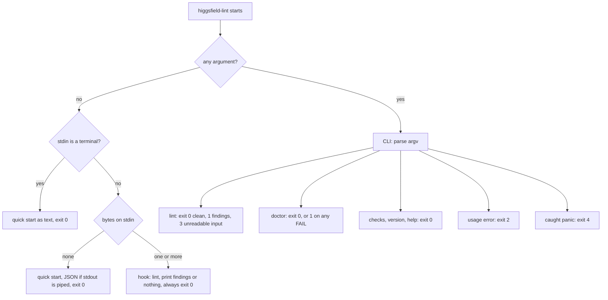

# higgsfield-lint

A small program that reads a Higgsfield image, video or audio generation request before
it is sent and points out when the written prompt contradicts the request's own
settings, such as a prompt that asks for "4K" while the request selects the 720p output
tier. One binary runs two ways: automatically, as a Claude Code hook on every Higgsfield
generation call made from this checkout, and by hand or by script, as a command-line
tool with JSON output built for AI coding agents.

> **Read before relying on it.** This is experimental, advisory software. It never
> blocks a generation and never edits a request; it only adds a note the model may act
> on. The checks are text heuristics against a model catalog captured on 2026-09-09, so
> they can miss real problems and can misfire on unusual phrasing. **Silence is not
> approval:** a clean result means no supported rule fired, which is also what you get
> when the model is not in the catalog. Higgsfield still bills for whatever it renders.
> The author accepts no responsibility for wasted credits, lost work or blocked calls.
> If a generation must be right, check it yourself.

Three names refer to one project: the GitHub repository is `0xdefence/higgsfield-guard`,
the Cargo package and binary are `higgsfield-lint`, and local worktrees may be named
`higgsfield-preprocessor`. The repository was deleted on 2026-09-02 and restored on
2026-09-10 with history intact; GitHub did not restore collaborator permissions, so
access must be re-granted by hand. There is no license file, so no reuse license is
granted.

## Status: what is real and what is not

| Piece | State on 2026-09-10 |
|---|---|
| Hook (`PreToolUse`) | Real. Wired by `.claude/settings.json` for this checkout only. Nothing is installed globally. |
| `resolution_claim` check | Real. Per-model option tables compiled into the binary from the 2026-09-09 capture. |
| `prompt_negative_conflict` check | Real. A fixed list of 18 directive phrases. |
| `duration_claim` check | Real. Over-claims only, video only, 27 listed models. |
| `negation_placement` check | Disabled on evidence. Its filter code is kept, unused, for a future volume-based rule. |
| Robot-mode CLI (`lint`, `doctor`, `checks`, `version`, `help`) | Real, added 2026-09-10 on branch `cli-robotcreation`. |
| `doctor` | Real: seven checks, plus a warning row when `CLAUDE_PROJECT_DIR` disagrees with the checkout. It cannot prove a running Claude Code session loaded the hook. |
| Model catalog | A snapshot. Higgsfield adds and removes models; unknown models are skipped silently. |
| Golden regression corpus | Real, 538 inputs, edited by hand only. No regeneration tool, by design. |
| Mutation gate | Real. Nine deliberate one-line breakages must each fail one named test. |
| Fresh clone | Broken until built. `target/` is ignored by git, so the configured hook command does not exist and exits 127 until `cargo build --release` runs. |
| Credit-expiry reminder | Proposed only (`docs/credit-expiry-task.md`). Nothing was scheduled. |
| Python implementation | Archived under `docs/archive/verified-port/`, read-only, never run. |
| Distribution | None. Build from source in this checkout; there is no release job or package. |
| Platforms | Linux and macOS in CI. Windows behaviour is not claimed. |

## Why it exists

Higgsfield is a hosted service that turns text prompts into images, videos and audio and
bills per generation in credits. It exposes its generators to AI assistants through MCP,
the Model Context Protocol, a standard way for an assistant such as Claude to call an
external tool with a JSON argument object. When Claude drafts a Higgsfield call it writes
both the prompt and the settings, and the two can disagree. On this account's real
history, three of nine lifetime video calls said "4K" in the prompt while requesting a
smaller output, and the same three asked for slow motion in the prompt while also listing
slow motion in the field that says what to avoid.

The obvious alternatives, and why they were not enough:

- **Higgsfield's own request validation** rejects wrong types and unknown option values.
  It does not read the prompt, so a legal request whose prose argues with its settings
  passes straight through. That gap is the whole job here.
- **A blocking gate.** The first design was a 990-line proxy that would refuse bad calls
  before they cost credits. Measuring the account killed it: over six months about 6,910
  credits expired unused against about 732 ever spent, and every one of the 11% of calls
  that failed was refunded in full. Blocking had nothing to protect, and a wrong block
  would cost the one scarce thing, the user's attention. The design is archived at
  `docs/archive/2026-08-30-preflight-gate-v1-rejected.md`; `SPEC.md` §13 lists what
  would bring it back.
- **Asking the model to re-read its own call.** That is what this does, with three
  differences: it is deterministic, it takes about two milliseconds, and the prompt it
  is reading cannot talk it out of a finding.

What remains is an advisory second reader. The cost of advisory mode is that a wrong
finding still lands in the model's context on every matching call, which is why every
confirmed false positive becomes a permanent test. `SPEC.md` §1 has the measurements.

## Concepts, from zero

**A Claude Code hook** is a program Claude Code runs at a fixed moment. `PreToolUse`
means "just before a tool call". Claude Code writes the call as JSON to the program's
standard input and reads its exit code and standard output. Exit 0 with a JSON document
on stdout can add text the model sees, called `additionalContext`. Exit 2 means "block
this call and show stderr to the model". Any other non-zero exit is ignored. The hook
path here only ever exits 0, which is what makes it advisory rather than blocking.

**A generation request** is `tool_input`, whose `params` object carries the prompt and
settings for one generation. Batch tools instead carry `requests`, a list of
`{index, params}` entries. `negative_prompt` is a second text field meaning "avoid
this". Higgsfield's catalog does not declare it for any model, which is why a check that
assumed models honour it was disabled.

**An output tier** is a named size such as `720p`, `1080p`, `4k` or `1.5k`. This
project compares tiers by rank inside one family only. `4k` against `1080p` is a video
convention it accepts; `2k` against `1080p` is not comparable and stays silent. It never
converts a tier into pixels or guesses what will render.

**Robot mode** means the command-line behaviour treats an AI coding agent as the primary
user: one machine-readable document per run, exit codes that carry meaning, errors that
name their cause and suggest a fix, and a first-contact help screen small enough not to
waste the agent's working memory.

## How we use it

### 1. Silently, on every Higgsfield call from this checkout

`.claude/settings.json` registers the binary against tool names matching
`mcp__.*__generate_(image|video|audio)(_batch)?$`. When Claude in this checkout calls
`generate_video`, Claude Code runs `target/release/higgsfield-lint` with no arguments
and the event on stdin. Nothing appears when the call is clean. When a rule fires,
Claude sees, for example:

```
higgsfield-lint: 1 finding
- prompt_negative_conflict: "slow motion" appears in both prompt and negative_prompt. Keep each term in one.
```

The call still proceeds. Batch findings are prefixed `request <index>:`.

To keep this working:

1. Run `cargo build --release` after any change under `rust/src`, `Cargo.toml` or
   `Cargo.lock`. The hook runs the built file directly. A stale binary runs old rules and
   a missing one exits 127, and neither can be told apart from "no findings".
2. Run `target/release/higgsfield-lint doctor` after building and expect 7 of 7 PASS.
3. Inside the Claude Code session, open `/hooks` and confirm this checkout's hook is
   listed, then look at one generation call's trace. Doctor works on the filesystem and
   cannot see inside a session. It also cannot prove that Claude Code's regex engine
   agrees with the Rust one on the matcher, that no other settings layer adds hooks, or
   that the binary's contents match the sources (it compares timestamps only).

Only this checkout is wired. Another project does not inherit the hook, and Higgsfield's
own shell CLI bypasses it entirely because the matcher is on MCP tool names.

### 2. By hand

```sh
target/release/higgsfield-lint                      # in a terminal: the quick start
target/release/higgsfield-lint doctor               # classic text report in a terminal
target/release/higgsfield-lint lint call.json --tool video
target/release/higgsfield-lint checks --text        # one line per check
```

Text is the default when stdout is a terminal. Add `--text` when piping, for example
into `less`, because a pipe selects JSON.

### 3. By an AI coding agent

An agent's shell has no terminal on either end, so output is JSON automatically and the
bare command prints the quick start instead of waiting on stdin:

```json
{"commands":{"checks":"list check ids and fixes","doctor":"hook install checks; exit 1 = FAIL","help":"[COMMAND]: help for one command","lint":"[FILE|-] --tool image|video|audio: lint a call; exit 1 = findings","version":"print name and version"},"exit":0,"exit_codes":{"0":"ok","1":"findings/fail","2":"usage","3":"input","4":"internal"},"hook":"no args + JSON on stdin = Claude Code hook (always exit 0)","name":"higgsfield-lint","ok":true,"summary":"lint Higgsfield generate_* calls for prompt/param contradictions","usage":"higgsfield-lint <command> [--json|--text]","version":"0.1.0"}
```

That document is about 600 bytes, roughly 130 to 150 tokens; tests hold it under 700
bytes. The loop an agent is expected to follow:

```sh
higgsfield-lint help lint                      # the full contract for one command
echo '{"model":"seedance_2_0","prompt":"shot in 4k","resolution":"720p"}' \
  | higgsfield-lint lint --tool video          # exit 1, document below
```

```json
{"exit":1,"findings":[{"check":"resolution_claim","message":"prompt says \"4k\" but resolution selects the \"720p\" output tier. Choose a supported higher tier, or revise the claim."}],"ok":false,"ran":["resolution_claim","prompt_negative_conflict","duration_claim"],"shape":"params","tool":"video"}
```

- Branch on the exit code first: 0 clean, 1 findings, 2 the call was wrong, 3 the input
  could not be read, 4 a bug in this program.
- Read `ran` before trusting `ok`. It lists the checks that apply to that tool kind.
  Audio runs none and says so in a `note` field.
- `shape` echoes how the document was read: `event` (a whole hook event with
  `tool_input`; the tool comes from `tool_name`), `tool_input` (has `params` or
  `requests`), or `params` (any other object, taken as one call's settings). Pass
  `--tool image|video|audio`, or a tool name such as `generate_video_batch`, unless the
  document is an event. `--tool=video` also works, and `-` means stdin.
- On a batch, each finding carries `request` with the entry's index.
- `higgsfield-lint checks` returns the phrase list and model list the checks watch, so
  an agent can avoid a finding instead of round-tripping.

Errors are one document on stdout, never a stack trace:

```json
{"error":{"code":"unknown_command","message":"unknown command \"lnt\"","suggestions":["did you mean \"lint\"?","run: higgsfield-lint help"]},"exit":2,"ok":false}
```

Error codes by exit class: `unknown_command`, `unknown_flag`, `unexpected_argument`,
`conflicting_flags`, `missing_value`, `missing_input`, `missing_tool`, `unknown_tool`
(exit 2); `file_not_found`, `read_failed`, `invalid_utf8`, `invalid_json`,
`unsupported_shape` (exit 3); `internal` (exit 4). In text mode errors go to stderr;
in JSON mode stderr stays empty. Output never contains colour codes.

## The checks

Checks run on `image` and `video` tools in this order, and each finding is one line:
`<check>: <what was seen>. <what to change>.`

| Check | Fires when | Stays silent when | Advice |
|---|---|---|---|
| `resolution_claim` | The prompt contains a standalone `4k`, `1080p`, `720p` or `480p` (any case) ranking above the tier the request declares through the model's `resolution`, `quality` or `mode` field, or above the requested pixels of a Topaz image upscale (`output_width`/`output_height`, short side under 2160, 1080, 720 or 480). | The model, field or option is outside the tables below; the claim sits inside double quotes; the pair is not comparable (a `1k`/`1.5k`/`2k` tier only fires against a `4k` claim); `seedance_2_0` in `fast` mode with `1080p` or `4k`; `marketing_studio_video` with any `width` or `height`. `8k`, `uhd` and `full hd` are treated as style words, not claims. | Choose a supported higher tier, or revise the claim. |
| `prompt_negative_conflict` | One of 18 directive phrases appears, not negated, in both `prompt` and `negative_prompt`. | The phrase follows `no`, `without`, `avoid` or `not` (up to three words later) in either field, or sits inside double quotes in the prompt. | Keep each term in one field. |
| `duration_claim` (video only) | The prompt describes more seconds of action than `params.duration`, for a listed model in an eligible mode, with `duration` between 1 and 600. | The model is unlisted; the mode is `video_edit`, `video_extension` or `edit`; the timing sits inside double quotes; or the claim is at or below the setting. | Check the model's supported duration or retime the beats. |

**Phrases** watched by `prompt_negative_conflict`: `slow motion`, `slow-mo`,
`motion blur`, `close-up`, `wide shot`, `handheld`, `blurred`, `blurry`, `camera pan`,
`whip pan`, `slow zoom`, `on-screen text`, `film grain`, `static shot`, `lens flare`,
`letterbox bars`, `watermark overlay`, `subtitles`. Bare `pan`, `text`, `sharp`,
`letterbox` and `watermark` were removed after confirmed false positives, a cast-iron
pan and a paper watermark among them. `blur` does not match `blurry`; there is no
stemming.

**Duration phrasings** that count: `Total: 15s`, `Total: 15 seconds`, `Total: 5.5s`,
`12 seconds`, `a 12-second shot`, `0–3s`, `12-15s`, `3s to 7s`, `15s total`. Not
counted: `15 secs`, `fifteen seconds`, `15 frames`, `Total 15s` without the colon,
`subtotal: 15s`, a reversed range such as `15–3s`, signed or comma numbers, and anything
inside double quotes.

**Resolution carriers.** The check reads `resolution` unless the model is one of the
four exceptions listed after the table.

| Models | Kind | Accepted `resolution` values |
|---|---|---|
| `gpt_image_2`, `gpt_image_2_5`, `cinematic_studio_2_5`, `marketing_studio_image`, `ms_image`, `nano_banana_pro`, `nano_banana_2` | image | `1k`, `2k`, `4k` |
| `nano_banana_2_lite` | image | `1k` |
| `flux_2`, `kling_omni_image`, `grok_image`, `grok_image_2_0`, `recraft_v4_1` | image | `1k`, `2k` |
| `seedream_v5_pro` | image | `1k`, `1.5k`, `2k` |
| `bytedance_image_upscale` | image | `2k`, `4k` |
| `cinematic_studio_3_0`, `seedance_2_0` | video | `480p`, `720p`, `1080p`, `4k` |
| `marketing_studio_video`, `grok_video_v15`, `seedance1_5`, `seedance_2_5`, `ad_multiplier`, `hf_mult_motion_control`, `hf_mult_replace_object`, `wan3_0`, `wan3_0_prime` | video | `480p`, `720p`, `1080p` |
| `flux_3_video`, `kling3_0_turbo`, `happy_horse_video`, `wan2_7` | video | `720p`, `1080p` |
| `minimax_h3` | video | `2k` |
| `minimax_h3_max` | video | `480p`, `768p` |
| `seedance_2_0_mini` | video | `480p`, `720p` |
| `topaz_video` | video | `1080p`, `2160p` |
| `bytedance_video_upscale` | video | `1080p`, `2k`, `4k` |
| `gemini_omni` | video | `720p` |
| `gemini_omni_flash_1_1` | video | `360p`, `720p`, `1080p`, `4k` |

Exceptions: `wan2_6` (video) reads `quality` in `720p`/`1080p`; `soul_2`,
`soul_cinematic` and `soul_v2` (image) read `quality` in `1.5k`/`2k`; `kling3_0` and
`kling_video_edit` (video) fire only when `mode` is `4k`; `topaz_image` and
`topaz_image_generative` (image) read `output_width` and `output_height` as positive
integers. Any other model is silent. `kling2_6`, the model in the one real fixture that
fires, has no resolution carrier and produces only the conflict finding.

**Modes** that must be recognised for a model to be checked at all: `grok_image`
(`std`, `quality`); `cinematic_studio_video_v2` (`pro`, `std`); `seedance_2_0` (`std`,
`fast`); `seedance_2_5` and `ad_multiplier` (`t2v`, `omni_reference`, `video_edit`,
`video_extension`); `kling3_0` and `kling_video_edit` (`std`, `pro`, `4k`);
`gemini_omni_flash_1_1` (`text-to-video`, `image-to-video`, `reference-to-video`,
`edit`, and `mode` is required). An unknown mode on one of these models silences every
check.

**Duration models**: `cinematic_studio_3_0`, `cinematic_studio_video`,
`cinematic_studio_video_v2`, `marketing_studio_video`, `flux_3_video`,
`grok_video_v15`, `minimax_hailuo`, `minimax_h3`, `minimax_h3_max`, `wan2_6`,
`seedance1_5`, `seedance_2_0`, `seedance_2_0_mini`, `seedance_2_5`, `ad_multiplier`,
`kling2_6`, `kling3_0`, `kling3_0_turbo`, `happy_horse_video`, `grok_video`,
`gemini_omni`, `gemini_omni_flash_1_1`, `wan2_7`, `wan3_0`, `wan3_0_prime`, `veo3_1`,
`veo3_1_lite`.

**Deliberately not checked:** model pixel ceilings, aspect-ratio claims, parameter
clamping and effective durations, bare `width`/`height` on models that declare a tier,
naked Hailuo sizes (`512`, `768`, `1080`), mixed `2k`-style against `1080p`-style
claims, negations inside `negative_prompt`, worded numbers, prompt quality, whether the
provider honours `negative_prompt` at all, and any tool outside the six matched names.
`SPEC.md` §5 and §11 give the reasons.

## Data shapes

The hook reads this envelope from stdin and ignores every other field:

```json
{"tool_name": "mcp__claude_ai_Higgsfield__generate_video",
 "tool_input": {"params": {"model": "seedance_2_0", "prompt": "...", "negative_prompt": "...", "resolution": "720p", "duration": 5}}}
```

`params` may also be a JSON-encoded string, which the single-call tool schemas allow.
Batch tools use `"tool_input": {"requests": [{"index": 0, "params": {...}}]}`; when
`requests` is a non-empty list the top-level `params` is never consulted.

The hook writes this, and only when there is at least one finding:

```json
{"hookSpecificOutput": {"hookEventName": "PreToolUse", "additionalContext": "higgsfield-lint: 1 finding\n- ..."}}
```

The CLI documents:

| Command | Shape |
|---|---|
| `lint` | `{ok, exit, tool, shape, ran[], findings[{check, message, request?}], note?}` |
| `doctor` | `{ok, exit, checks[{name, status: pass\|warn\|fail, detail}], summary{pass, warn, fail}, note}` |
| `checks` | `{ok, exit, checks[{id, tools[], fires, fix, silent_when, phrases?, models?}]}` |
| `version` | `{ok, exit, name, version}` |
| `help` | `{ok, exit, command, usage, description, arguments, flags, input, output, exit_codes, examples}` |
| any error | `{ok: false, exit, error{code, message, suggestions[]}}` |

Keys come out in alphabetical order; the order is not significant.

How one invocation is routed:



## Architecture

```
rust/src/main.rs     dispatch (above), then the hook path: read stdin, lint, print, exit 0
rust/src/cli.rs      robot mode: argv, output formats, structured errors, help table, the commands
rust/src/lint.rs     tool classification, params resolution, batch handling, check order, render()
rust/src/checks.rs   the three checks, their lexicons, the per-model tables, text normalisation
rust/src/doctor.rs   the seven install checks and both report formats
```

Dependency direction is one way: `main` calls `cli`, `lint` and `doctor`; `cli` calls
`lint`, `checks` and `doctor`; `checks` is a leaf. Two crates are compiled in,
`serde_json` and `regex`; nothing is fetched at run time and nothing is written to disk
or the network by any path. The release profile pins `panic = "unwind"`: the hook path
catches panics and turns them into silence, and the CLI turns them into exit 4, so an
abort profile would break both.

Rules that keep the hook safe, each pinned by a test:

- The hook path never exits non-zero, never writes to stderr, and never reads a file.
  Malformed JSON, invalid UTF-8, a missing field or a caught panic all produce exit 0 and
  empty output.
- Findings render in a fixed order, and the rendered text is part of the contract the
  golden corpus checks.
- Any argument selects the CLI. A stray argument in `.claude/settings.json` would make
  the hook exit 2 and block every generation, so doctor's "matcher present" check fails
  on a command that carries one.

## Build, test, where things live

```sh
cargo build --release                        # required after any source change
target/release/higgsfield-lint doctor        # 7 of 7 PASS expected
cargo test --release                         # 155 tests, including 538 golden inputs
cargo test --test fail_silent --test cli     # debug profile: real panic injection
```

Use `--release` for the full suite. A plain `cargo test` builds a debug binary at a path
`.claude/settings.json` does not name, so the `doctor` target fails there by design;
`ci/verify.sh` runs the right subset in each profile. CI pins Rust 1.98.0 and nothing
pins it locally; the code needs a recent stable toolchain. The mutation driver needs
Python 3.9 or later.

Everything lives in this checkout: the binary at `target/release/higgsfield-lint`
(ignored by git), the hook wiring in `.claude/settings.json`, two real captured calls in
`tests/fixtures/` (a Kling 2.6 call expected to produce exactly the conflict finding, and
a Seedance 2.5 call expected to be silent), the golden corpus in
`rust/tests/golden/expectations.json`, and the MCP capture the model tables are checked
against in `docs/evidence/`. The `data/` directory holds only a `.gitkeep`; doctor uses
it as the landmark to find the repository root, and one doctor check fails if the
retired `data/negative_prompt_models.json` ever reappears. Nothing is written at run
time, so there is nothing to back up beyond the repository.

`ci/verify.sh` mirrors the CI contract job: it unsets `CLAUDE_PROJECT_DIR`, cleans this
package's release artifacts, builds, runs the release suite, runs the debug subset, and
ends with `doctor --text`. `ci/mutation_checks.py` copies the sources to a temporary
directory, applies nine one-line breakages one at a time, and requires one specific
named test to fail for each. `docs/CI.md` describes the GitHub Actions jobs; the
`CI required` check must be enabled by the repository owner to block merges.

## Rules that must not be quietly reversed

Each was decided deliberately. A change that undoes one without saying so is a
regression, not a cleanup.

- **`SPEC.md` changes first, then code.** A rule change and its spec change are one unit.
- **No golden regeneration tool, ever.** A flipped expectation is edited by hand, one
  label at a time, in the same commit as the behaviour change, and recorded in
  `docs/golden-change-ledger.json`. The corpus floor is 538 inputs.
- **Never edit a fixture or a test to make a red diff green.** A confirmed false positive
  becomes a permanent negative control, shown failing before the fix and passing after.
- **The archived Python is never edited** to match later behaviour. It records what was
  verified on a date (320 inputs with zero divergences, plus 4,200 fuzzed inputs, once);
  nothing in the repository can rerun that comparison.
- **The hook never returns `permissionDecision: "deny"`.**
- **The nine mutation anchors in `ci/mutation_checks.py` are exact source strings.** A
  refactor that moves one must update the probe in the same change.
- **Doctor stays at seven checks** unless its tests and this file move with it.
- **Creating the credit-expiry reminder is a human action** against a live account.

## What is next

- Scheduling the credit-expiry reminder, if it is still wanted.
- A volume-based replacement for the disabled `negation_placement` check (research id
  HFR-006); its noise filter is kept in `checks.rs` and its thresholds are uncalibrated.
- Refreshing the model tables from a new `models_explore` capture when Higgsfield
  changes its lineup. The constants and their cross-check test move together.
- Proving, in a live session, that this checkout's hook is loaded. Nothing in the
  repository can.
- A packaging or install path, which would also need the settings command to stop
  pointing at `target/release`.

## Pointers

- `SPEC.md`: the design, the measurements, the rules, the hook and CLI contracts (§6, §6.1).
- `docs/superpowers/specs/2026-09-10-robot-mode-cli-design.md`: why the CLI dispatches on
  stdin the way it does.
- `docs/higgsfield-canonical-contract.md` and `docs/evidence/`: the dated MCP capture
  behind the model tables.
- `HIGGSFIELD_PROMPT_RESEARCH.md`: the evidence behind every lexicon entry and every
  disabled rule. `PLAN.md` and `docs/superpowers/plans/` are the implementation plans.
- `docs/CI.md`: the CI jobs and how to reproduce them locally.
- `rust/tests/golden/README.md` and `docs/golden-change-ledger.json`: how to change an
  expectation, and the record of every change so far.
- `docs/2026-09-10-readme-audit.md`: the code audit this file was rewritten against.
- `docs/codebase-orientation.md`: a dated snapshot from 2026-09-09, kept for the record
  and marked superseded.
- `docs/archive/`: the rejected blocking design and the retired Python port.
- License: none. Contributions: pull requests against `main` must pass `CI required`.
