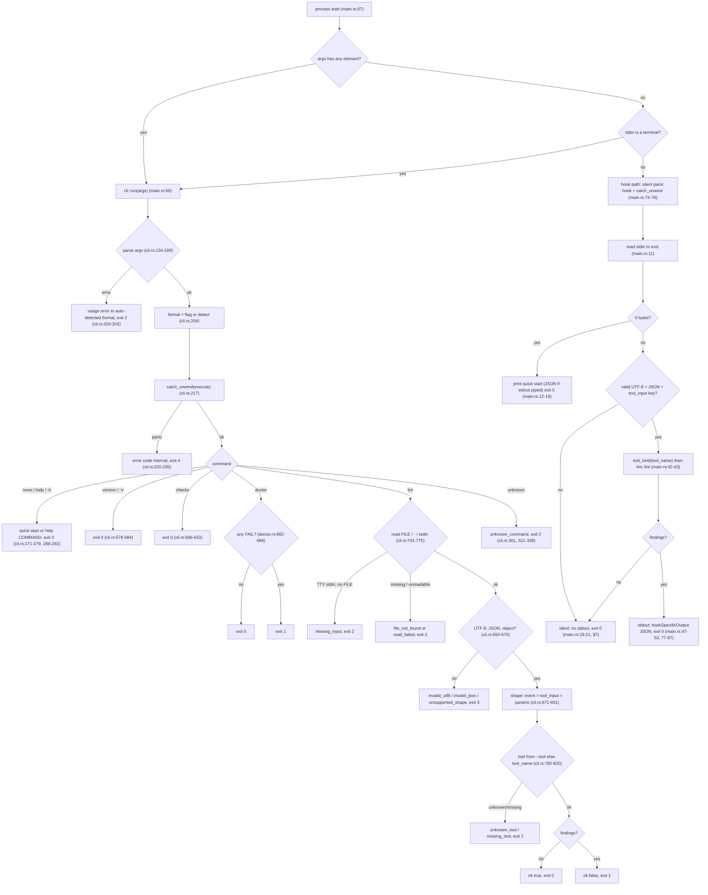

# README audit — `higgsfield-lint`, 2026-09-10

Audited: the uncommitted working tree of the `cli-robotcreation` worktree (HEAD `a826674`
plus 15 modified files and the untracked `rust/src/cli.rs`, `rust/tests/cli.rs`). Every
claim below cites `file:line` in that tree. The only executions performed were read-only
invocations of the already-built `target/release/higgsfield-lint` (`help`, `help <cmd>`,
`checks`, `version`, `doctor --text`, `doctor --json`, and `lint` on stdin/fixtures); no
build, test, network, or file write other than this document.

Line numbers for `README.md` refer to the 88-line working-tree file.

---

## 1. Coverage matrix

Verdict legend: **Accurate** / **Overstated** / **Understated** / **Missing from doc** /
**In doc but not in code**.

| Capability | Where in code (file:line) | README says | Verdict | Notes |
|---|---|---|---|---|
| **Dispatch: hook vs CLI** | | | | |
| Any argv element at all selects the CLI, never the hook | `rust/src/main.rs:67-70` | L55-57: "a stray argument in `.claude/settings.json` is reported by `doctor`, since the CLI would otherwise exit 2 and block the call" | Accurate | Replaced the old "unrecognised argument falls through to the hook" rule (design doc `docs/superpowers/specs/2026-09-10-robot-mode-cli-design.md:48-54`). |
| No args + stdin is a terminal selects the CLI quick start | `rust/src/main.rs:68` (`std::io::stdin().is_terminal()`), `rust/src/cli.rs:277-279` | L41: "Run it with no arguments in a terminal … for a quick start" | Accurate | Format then follows stdout: text if stdout is a TTY, JSON otherwise (`cli.rs:51-57`). |
| No args + non-terminal stdin + **0 bytes** prints the quick start on stdout, exit 0, empty stderr, via the hook path | `rust/src/main.rs:9-18`, `rust/src/cli.rs:241-247`; tested `rust/tests/cli.rs:84-101` | L34: "empty stdout when no findings"; nothing about the 0-byte case | Overstated (L34) / Missing | SPEC §7 `SPEC.md:395-398` records the exception; README does not. Verified: `higgsfield-lint </dev/null` printed the JSON quick start, exit 0. |
| No args + non-terminal stdin + **≥1 byte** is the hook, exit 0 unconditionally | `rust/src/main.rs:19-53, 75-87`; boundary pinned `rust/tests/cli.rs:120-126`, `rust/tests/fail_silent.rs:23` | L55-56: "With no arguments and the event JSON on stdin the binary is still the hook and always exits 0" | Accurate | A lone `\n` stays on the silent path (verified in tests, not re-run). |
| Hook reads the whole of stdin, requires valid UTF-8, valid JSON, and a `tool_input` key; otherwise silent | `rust/src/main.rs:10-21` | Not stated | Missing from doc | The envelope is described only in SPEC §3 `SPEC.md:61-67` and §9 `SPEC.md:428-432`. |
| `tool_name` is read from the event and classified | `rust/src/main.rs:42`, `rust/src/lint.rs:35-50` | L7-9: image, video, audio tools; "Audio skips these text checks" | Understated | README never says batch tools (`_batch`) are covered, that names are matched case-sensitively as the last `__` component of an `mcp__…` name, or what happens to an unknown/missing name. |
| Unknown / missing `tool_name` in the hook still runs `prompt_negative_conflict` (resolution and duration skip) | `rust/src/lint.rs:84-98` (conflict has no kind gate), `rust/src/checks.rs:461-463` (resolution kind gate); adversarial proof `rust/tests/adversarial.rs:248-255` | Not stated | Missing from doc | Verified: event with `tool_name: mcp__x__generate_3d` and matching prompt/negative fired `prompt_negative_conflict`. Internal inconsistency: `lint::checks_for(ToolKind::Unknown)` returns `&[]` (`rust/src/lint.rs:23`) while `lint_params` still runs the conflict check for Unknown; unreachable from the CLI because `resolve_tool` rejects Unknown (`rust/src/cli.rs:788-796`). SPEC §5.4 table (`SPEC.md:277-282`) matches the code, not `checks_for`. |
| Batch tools: non-empty `requests` array is linted per entry; top-level `params` is **never** consulted then; empty list falls back to `params`; non-object entries and unresolvable `params` are skipped; `index` (any JSON type) is rendered Python-`str()` style with positional fallback; findings prefixed `request <index>: ` | `rust/src/lint.rs:151-185`, `rust/src/lint.rs:100-138` (format_index), `rust/src/lint.rs:190-202` (render) | Not stated | Missing from doc | SPEC §6 `SPEC.md:320-321` and §9 `SPEC.md:428-432` cover it. |
| `params` accepted as an object **or** a JSON-encoded string that decodes to an object | `rust/src/lint.rs:59-72` | Not stated | Missing from doc | SPEC §9 `SPEC.md:428-432`. |
| Hook output: one JSON object `{"hookSpecificOutput":{"hookEventName":"PreToolUse","additionalContext":"…"}}`, no trailing newline; nothing at all when no findings | `rust/src/main.rs:44-53, 77-86` | Not stated (L34 says "empty stdout when no findings") | Missing from doc | Verified: output ends `"}}` with no newline (CLI JSON documents do end with `\n`, `rust/src/cli.rs:252`). |
| Hook never returns `permissionDecision: "deny"` | No such string anywhere in `rust/src/`; exact-envelope assertion `rust/tests/adversarial.rs:72-76` | L7: "Advisory" | Accurate | "Advisory" is never defined in the README; SPEC §4 `SPEC.md:78-89` is the explanation. |
| Fail-open guarantee: exit 0 always, silent panic hook, `catch_unwind`, `panic = "unwind"` release profile, stdout write/flush errors ignored | `rust/src/main.rs:75-87`, `Cargo.toml:34-37` | L34-36 | Understated | README says "fail-open" and mentions "OS-level abort" but not that panics are caught, nor which failures cannot be caught (allocator abort, stack overflow, SIGKILL, exit 127 for a missing binary — `rust/src/checks.rs:185-191`, SPEC §7 `SPEC.md:404-406`, §12.1 `SPEC.md:535-545`). |
| Debug-only panic injection on `params.__panic__ == true` (hook and CLI), compiled out of release | `rust/src/main.rs:22-41`, `rust/src/cli.rs:694-701`; tests `rust/tests/fail_silent.rs:53-76`, `rust/tests/cli.rs:547-561` | L21 lists `cargo test --test fail_silent` without saying why it must run in debug | Missing from doc | SPEC §9 `SPEC.md:434-436` explains. |
| **Check: `resolution_claim`** | | | | |
| Trigger: tool kind Image/Video; `model` is a string; `known_mode` passes; a supported carrier exists — Topaz `output_width`/`output_height` positive integers, or `quality` (wan2_6 / soul_*), or `mode` (kling3_0 / kling_video_edit, only `4k`), or `resolution` in `resolution_options`; prompt is a string; first lexicon term (`4k`, `1080p`, `720p`, `480p`, case-insensitive, token-bounded) found outside paired double quotes; mismatch = K tier below a `4k` claim, or p tier numerically below the claim, or Topaz `min(w,h)` below threshold | `rust/src/checks.rs:460-501` (submitted_size), `:388-410` (known_mode), `:340-386` (resolution_options), `:419-437` (Tier), `:504-536` (check), `:34-35` (lexicon), `:326-336` (quoted_spans) | L8 "supported output-tier claims"; L61-63 | Accurate (scope), Understated (id) | README never gives the check id `resolution_claim`, never names any model, and never says which single-field carriers are recognised. Verified: `nano_banana_pro` + prompt "1080p" + `resolution: "2k"` is **silent** (K tiers only fire on a `4k` claim, `checks.rs:434`), which the `checks` command's `fires` text (`cli.rs:591`) slightly overstates. |
| Silence: unknown model/field/option, wrong kind, missing prompt/setting, quoted claim, `8k`/`uhd`/`full hd`, non-string mode or unknown mode on mode-sensitive models, `gemini_omni_flash_1_1` without `mode`, `marketing_studio_video` with any `width`/`height`, `seedance_2_0` fast + `1080p`/`4k`, Topaz non-integer/≤0/u64-overflow targets, bare `width`/`height` | `rust/src/checks.rs:461-495, 452-458, 405-409` | L12-13, L61-67 | Accurate | Well described in prose; ids and model names absent. |
| Message wording: `prompt says "<original spelling>" but <field> selects the "<label>" output tier. Choose a supported higher tier, or revise the claim.` / Topaz variant names requested `output_width x output_height` and the short side | `rust/src/checks.rs:522-535` | Not stated | Missing from doc | SPEC §5.1 `SPEC.md:130-134`. |
| At most one resolution finding per entry; highest-threshold claim wins (lexicon order) | `rust/src/checks.rs:509-512` | Not stated | Missing from doc | SPEC `SPEC.md:104, 133-134`. |
| **Check: `prompt_negative_conflict`** | | | | |
| Trigger: `prompt` and `negative_prompt` both strings; both normalised, negation-stripped, lower-cased; a `CONFLICT_PHRASES` entry is found in the prompt outside paired quotes **and** anywhere in the negative field (quotes not excluded there) | `rust/src/checks.rs:785-830` | L8-9 "local prompt/negative-prompt overlap"; L13 | Understated | Id, phrase list and the asymmetry (quote exclusion applies to the prompt only, `checks.rs:807-810`) are absent. |
| Silence: either field missing/non-string; phrase negated (`no|without|avoid|not` + up to 3 words) in either field; quoted in prompt; split by newline or punctuation; inflection (`blur` vs `blurry`) | `rust/src/checks.rs:724-726, 778-780, 807`; tests `:1378-1418, 1705-1732` | L13 "local text consistency—not proof the provider honors it" | Accurate | |
| Quote pairing is positional (1st/2nd, 3rd/4th); unpaired trailing quote ignored; inch marks can swallow a directive; `""term""` stays live | `rust/src/checks.rs:309-336`; tests `:956-989, 1737-1753` | L66 "Quotes … are supported" | Understated | Documented in SPEC §5.2a `SPEC.md:235-237`. |
| Message: `"<phrase>"[, "<phrase>"] appear(s) in both prompt and negative_prompt. Keep each term in one.` | `rust/src/checks.rs:816-829` | Not stated | Missing from doc | SPEC §6 example `SPEC.md:324-331`. |
| **Check: `duration_claim`** | | | | |
| Trigger: Video kind only; `model` in `DURATION_MODELS`; `known_mode`; not seedance_2_5/ad_multiplier in `video_edit`/`video_extension`, not gemini_omni_flash_1_1 `edit`; `duration` is a finite JSON number in `1..=600`; prompt string; grammar match not glued to a preceding alnum/`_+-–—.,:` or following alnum/`_`, not overlapping a quote span; ranges require from ≤ to; maximum claim; fires only when claimed > supplied | `rust/src/lint.rs:92-96`, `rust/src/checks.rs:570-581, 585-594, 596-641, 651-671` | L9 "video duration over-claims"; L64-65 | Accurate (scope), Understated (id, grammar, model list) | Fractional supplied values (e.g. 5.5) are accepted (`checks.rs:655`, test `:1503-1506`) even though the MCP schema is integer — SPEC `SPEC.md:305-306` calls this tolerance. |
| Message: `prompt describes <N>s of action but the supplied duration is <M>s. Check the model's supported duration or retime the beats.` | `rust/src/checks.rs:665-668`, `:642-650` (display capped at 24 chars, else `{:.6e}`) | Not stated | Missing from doc | |
| **Check ordering and ids** | `rust/src/lint.rs:84-98` (resolution → conflict → duration), `:15-25` (`checks_for`) | Not stated | Missing from doc | The three ids appear nowhere in the README. |
| Shared text normalisation (curly quotes → `"`, fullwidth → ASCII, NBSP/ideographic space/tab → space, CR/CRLF → LF, horizontal runs collapsed, original spelling recovered) | `rust/src/checks.rs:41-49, 79-116` | L65-66 "a narrow set of typography folds" | Accurate | SPEC §5.2a `SPEC.md:217-240`. |
| Disabled `negation_placement`: regex, stoplist and `is_placement_noise` retained unused for HFR-006 | `rust/src/checks.rs:740-774` | Not stated | Missing from doc | SPEC §5.3 `SPEC.md:242-269`. |
| **CLI: commands and flags** | | | | |
| Commands `lint`, `doctor`, `checks`, `version`, `help`; aliases `-h`/`--help` → help, `-V`/`--version` → version | `rust/src/cli.rs:122, 169-170, 268-276, 287-302` | L45-50 shows `help lint`, `lint`, `doctor --json`, `checks`; `version` and the aliases are not mentioned | Understated | SPEC §6.1 `SPEC.md:354-356` lists them all. |
| `--json` / `--text` anywhere in argv; both → `conflicting_flags`; repeating the same one is harmless | `rust/src/cli.rs:140-154`; test `:860-880` | L42 | Accurate | |
| Format auto-detect: JSON when stdout is not a terminal | `rust/src/cli.rs:51-57` | L42 | Accurate | |
| `--text`/`--json` are **ignored for argv-parse errors** (unknown flag, missing `--tool` value, conflicting flags): the error is emitted in the auto-detected format | `rust/src/cli.rs:200-203` (`emit(Format::detect(), Err(e))`) | L42 "`--json` and `--text` override that" | Overstated | Verified: `higgsfield-lint --text --bogus` with piped stdout printed a JSON error on stdout. SPEC §6.1 `SPEC.md:356-359` does not mention the exception either. |
| `--tool T` and `--tool=T`; values `image`/`video`/`audio` or any name `lint::tool_kind` accepts; `--tool` on a non-lint command → `unknown_flag`; missing value → `missing_value`; unknown value → `unknown_tool` | `rust/src/cli.rs:155-168, 280-286, 780-797` | L47 `--tool video` only | Understated | `--tool=` form is undocumented everywhere (README, SPEC, `help lint`). Verified `--tool=video` works. |
| `lint [FILE|-]`: FILE read with `std::fs::read`; `-` or omitted = stdin; omitted + TTY stdin → `missing_input` (exit 2); unreadable path → `read_failed` (exit 3); missing → `file_not_found` (exit 3) | `rust/src/cli.rs:741-775` | L46-48 | Understated | Verified `lint /tmp --tool video` → `read_failed`, exit 3. |
| Three payload shapes tested in order `event` (has `tool_input`) → `tool_input` (has `params` or `requests`) → `params` (any other object), echoed as `shape`; non-object document or non-object `tool_input` → `unsupported_shape` | `rust/src/cli.rs:664-691` | L48 comment "tool comes from tool_name" | Understated | The second `unsupported_shape` case (`tool_input` not an object, `cli.rs:673-679`) is documented nowhere. |
| `lint` output: `{ok, exit, tool, shape, ran, findings:[{check, message, request?}], note?}`; `ok` = no findings; exit 1 on findings | `rust/src/cli.rs:703-738` | Not stated beyond exit code | Missing from doc | SPEC §6.1 `SPEC.md:376-381`. Verified against the README's own `echo … \| lint --tool video` example: exit 1, one `resolution_claim` finding. |
| `lint --text` prints exactly the hook's `additionalContext` plus `\n`; for a clean call prints `higgsfield-lint: 0 findings` (the hook prints nothing in that case) | `rust/src/cli.rs:728`, `rust/src/lint.rs:190-202` | Not stated | Missing from doc | Verified. SPEC `SPEC.md:381` "Text mode prints exactly the additionalContext text" is not literally true for the zero-findings case. |
| Audio: `ran: []`, `note: "audio: prompt is spoken text, no text checks apply"`, exit 0 | `rust/src/cli.rs:729-733` | L9 "Audio skips these text checks" | Understated | Verified. |
| `checks` output: static table `[{id, tools, fires, fix, silent_when, phrases?, models?}]`; text mode one line per check | `rust/src/cli.rs:586-633` | L50 (command name only) | Understated | `phrases` = `CONFLICT_PHRASES`, `models` = `DURATION_MODELS` (`cli.rs:601, 609`). The resolution row has no model list — it points at `docs/higgsfield-canonical-contract.md` (`cli.rs:593`). |
| `version` output `{ok, exit, name, version}` / `higgsfield-lint 0.1.0` | `rust/src/cli.rs:578-584`, `Cargo.toml:3` | Not stated | Missing from doc | |
| `help` quick start: text ≤ 620 bytes, JSON ≤ 700 bytes (tests), measured 600 bytes text | `rust/src/cli.rs:465-514, 893-898`; `rust/tests/cli.rs:97, 150` | L41 "a quick start of about 100 tokens" | Overstated | Nothing measures tokens; the bound is bytes. 600 bytes is roughly 150–200 tokens for common tokenizers. |
| `help COMMAND` rendered from one `COMMAND_DOCS` table in both formats; unknown command → `unknown_command` exit 2; extra positional → `unexpected_argument` | `rust/src/cli.rs:368-463, 524-574, 288-292` | L45 `help lint` | Accurate | |
| Positional after `version`/`checks`/`doctor` → `unexpected_argument` (exit 2) | `rust/src/cli.rs:293-295, 305-311` | Not stated | Missing from doc | Verified `version extra` → exit 2. |
| Unknown command suggestions: nearest command within Levenshtein 2 (case-folded), plus a `lint <name> --tool …` hint when the name ends in `.json` or contains `/` | `rust/src/cli.rs:321-364` | Not stated | Missing from doc | Verified `higgsfield-lint call.json` → hint to use `lint call.json`. |
| Exit codes 0 ok / 1 findings or doctor FAIL / 2 usage / 3 input / 4 internal | `rust/src/cli.rs:27-38` | L53 | Accurate | |
| Error document `{"ok":false,"exit":N,"error":{"code","message","suggestions":[…]}}` on stdout in JSON mode; `error[<code>]: <message>` + indented suggestions on stderr in text mode | `rust/src/cli.rs:96-115, 249-265` | L53-55 (JSON only) | Understated | Text-mode stderr behaviour undocumented in README (SPEC `SPEC.md:358-359` has it). |
| 14 error code strings (8 usage, 5 input, 1 internal) | see §2 below | None listed | Missing from doc | SPEC §6.1 `SPEC.md:365-369` lists them. |
| CLI panic → `internal`, exit 4, structured, no stderr; panic message captured via a custom hook into a `Mutex<Option<String>>`; argv parsing runs outside the guard | `rust/src/cli.rs:193-237` | L53 "4 internal" | Accurate (code), Understated (mechanism) | Only provable in a debug build (`rust/tests/cli.rs:547-561`). |
| No ANSI escapes ever; one newline-terminated JSON document per invocation; never `println!` (closed-pipe safety) | `rust/tests/cli.rs:64-68`, `rust/src/cli.rs:250-263` | Not stated | Missing from doc | SPEC `SPEC.md:357-359`. |
| **Doctor** | | | | |
| Seven ordered checks — `binary location`, `data file`, `binary freshness`, `settings file`, `matcher present`, `matcher correctness`, `self-test` — plus a **conditional eighth** `project dir` WARN row when `CLAUDE_PROJECT_DIR` disagrees with the discovered root | `rust/src/doctor.rs:28-37, 100-168, 138-142, 370-382` | L26 "Doctor checks seven local conditions" | Understated (inexact) | The disagreeing case yields 8 rows (`rust/tests/cli.rs:651-652`: `fail 2, warn 1` on top of 5 passes). |
| Check 1 `binary location`: walks up from `current_exe()` until a directory containing `data/` is found; that directory is the repo root for every later check | `rust/src/doctor.rs:103-126, 171-180` | Not stated | Missing from doc | `data/.gitkeep` exists only for this (`ls data/` shows the single empty file; SPEC `SPEC.md:462`). Deleting `data/` fails all seven. |
| Check 2 `data file`: passes when `data/negative_prompt_models.json` is **absent**, fails if it reappears | `rust/src/doctor.rs:182-201` | Not stated | Missing from doc | SPEC §5.3 `SPEC.md:267-269`. |
| Check 3 `binary freshness`: mtime of the exe vs `Cargo.toml`, `Cargo.lock`, every `*.rs` under `rust/src` recursively; any symlink under `rust/src` → FAIL; requires `main.rs`, `lint.rs`, `checks.rs`, `doctor.rs` to exist (list does **not** include `cli.rs`) | `rust/src/doctor.rs:203-280` | L26-28 "recursive source/manifest/lockfile freshness … a heuristic, not a build fingerprint" | Accurate | `cli.rs` is still mtime-checked by the recursive walk; only the "required input" pre-check at `:227` is stale. |
| Check 4 `settings file`: `<root>/.claude/settings.json` parses and `hooks.PreToolUse` is a non-empty array | `rust/src/doctor.rs:282-309` | Not stated | Missing from doc | Only the project-level file is read; user/local/enterprise settings are not consulted. |
| `project dir` resolution: `CLAUDE_PROJECT_DIR` env if set and non-empty, else the discovered root; disagreement → WARN and the env value is used for checks 5–6 | `rust/src/doctor.rs:311-417, 138-144` | Not stated | Missing from doc | `help doctor` says "reads CLAUDE_PROJECT_DIR when set" (`cli.rs:422`). |
| Check 5 `matcher present`: some `hooks[].command`, with surrounding quotes trimmed and `$CLAUDE_PROJECT_DIR` substituted, canonicalises to this executable; any trailing argument makes it fail | `rust/src/doctor.rs:419-497`; test `:1371-1398` | L56-57 | Accurate | |
| Check 6 `matcher correctness`: the matcher on that entry, compiled with the Rust `regex` crate, matches 12 should-match names (two server-id styles × six tools) and rejects 5 lookalikes | `rust/src/doctor.rs:499-582` | L27 "six-tool matcher coverage" | Accurate | Doc comment at `doctor.rs:523` still says "rejects the two nearest lookalikes"; the list has five. |
| Check 7 `self-test`: in-process `lint::lint` on a synthetic offending payload expecting exactly `["resolution_claim","prompt_negative_conflict"]`, four scope/typography controls, then **reads both fixture files from disk** and expects `["prompt_negative_conflict"]` / `[]` | `rust/src/doctor.rs:588-680` | L27 "actual fixtures" | Accurate | In-process: it does not spawn the binary, so stdin/stdout/exit plumbing in `main.rs` is not exercised. |
| Exit 1 if any FAIL; WARN never fails | `rust/src/doctor.rs:682-688` | L53 | Accurate | |
| Doctor JSON `{ok, exit, checks:[{name,status,detail}], summary:{pass,warn,fail}, note}`; text is the classic `[PASS] name: detail` report ending with the note | `rust/src/doctor.rs:64-95` | L49 `doctor --json` | Understated | JSON `note` has the trailing period stripped (`doctor.rs:93`). |
| What doctor cannot prove | `rust/src/doctor.rs:39` (REPORT_NOTE), `:264` (mtime caveat), `:311-330` (project-dir blind spot) | L28, L31 | Accurate | See §4 for the full list (regex engine, settings precedence, session state, content identity, in-process self-test). |
| **Tests, corpus, CI** | | | | |
| Five integration test targets (`fail_silent`, `parity`, `doctor`, `adversarial`, `cli`) plus unit tests in the bin | `Cargo.toml:10-28` | L20-21 name only `cargo test --release` and `--test fail_silent` | Understated | |
| Plain `cargo test` (debug, default) will fail the `doctor` target and three `cli` doctor tests are `#[cfg(not(debug_assertions))]` because `.claude/settings.json` names the **release** path | `rust/tests/cli.rs:610, 637, 664`; `rust/tests/doctor.rs:62-65`; `ci/verify.sh:15-17` | Not stated | Missing from doc | A stranger who runs `cargo test` gets red; `docs/CI.md:70-72` explains, README does not. (Reasoned from code; not executed.) |
| Golden corpus: 538 distinct inputs, FNV-1a hashed, compared as parsed JSON; missing/orphaned/colliding labels fail; count may not drop below 538; **no regeneration tool**; `audit_golden_changes` is `#[ignore]` and read-only | `rust/tests/parity.rs:1319-1424, 1293-1295`; `rust/tests/golden/expectations.json` (`count: 538`, 538 entries, 368 `null` outputs); `rust/tests/golden/README.md:30-57` | L82-83 | Accurate (538, 191), Overstated ("preserves historical input bytes") | One historical entry (`pathological:empty`) was removed and replaced by `pathological:whitespace_only` on 2026-09-10 (`rust/tests/golden/README.md:76-83`; ledger: 192 added / 87 modified / 1 removed). 346 of 347 historical inputs are byte-preserved. |
| Semantic cases: 191 (112 positive, 59 negative, 17 robustness, 3 limitation); minima enforced (≥191, ≥59 negatives, ≥3/≥17/≥13 limitation/robustness/repeated-determinism, 92/9/16 distinct positives by rule) | `rust/tests/parity.rs:1201-1291`; `rust/tests/golden/semantic-cases.json` | L83 "191 independently specified semantic cases" | Accurate | |
| Research-mapping test: every `\| F-…` row in `rust/tests/golden/README.md` must reference a live corpus label or a `unit:` test function; exactly 65 ids | `rust/tests/parity.rs:1119-1173` | Not stated | Missing from doc | |
| Adversarial suite: paired bad/good, hostile text, shell-substitution sentinel, quote/near-miss, scope, 7×7 malformed cross-product, batch masking, long quoted input; 20 s hang guard | `rust/tests/adversarial.rs:9-54, 96-337` | L75 "adversarial scenarios" | Accurate | |
| `fail_silent`: 12 pathological stdins, debug panic injection, dispatch invariance | `rust/tests/fail_silent.rs:17-87` | L21 | Accurate | |
| Mutation gate: 9 named mutants, each must be killed by one exact-named test; compile errors/timeouts never count | `ci/mutation_checks.py:17-48, 51-60, 127-128` | L76 "nine deliberate-mutation probes" | Accurate | |
| CI: 4 jobs (`quality`, `contracts` ×{ubuntu-24.04, macos-14}, `mutations`, `required`), Rust 1.98.0, actions pinned to SHAs, `contents: read`, no cache | `.github/workflows/ci.yml:1-107` | L75-77 | Accurate | |
| `ci/verify.sh` steps | `ci/verify.sh:7-19` | L17-22 (approximation) | Understated | See §4. |
| **Runtime, deps, distribution** | | | | |
| Two direct deps `serde_json`, `regex` | `Cargo.toml:30-32` | L85 | Accurate | 13 transitive crates in `Cargo.lock`. |
| No network, no filesystem reads or writes on the hook path | `rust/src/main.rs` (only `std::io::stdin/stdout`); no `std::net`/`std::fs` in `lint.rs`/`checks.rs` | L85-86 | Accurate | `checks.rs:1549` `include_str!` of the evidence JSON is compile-time and test-only. |
| Hook wired only by project-level `.claude/settings.json` via `$CLAUDE_PROJECT_DIR/target/release/higgsfield-lint` | `.claude/settings.json:5-9` | L25-26 | Accurate | |
| `target/` is gitignored: a fresh clone has **no binary** and the hook exits 127 until built | `.gitignore:9`; SPEC §12.1 `SPEC.md:535-545` | L17-24 (build steps) | Missing from doc | README never states that the configured hook is broken until `cargo build --release` has run in that checkout. |
| No install/release/distribution path; nothing installed globally | Absence: no `install` target, no release workflow (`.github/workflows/` contains only `ci.yml`), no `cargo install` docs | L32 | Accurate | |
| Credit-expiry reminder: proposed only, never created | `docs/credit-expiry-task.md:3, 47-51`; nothing in code | L86-87 | Accurate | |
| Archived Python: read-only historical record | `docs/archive/verified-port/README.md:1-6`; not referenced by any runtime code | L79-81 | Accurate | |
| Repository deletion/restoration note | `README.md:3-5`; `docs/PR_DESCRIPTION.md:3-8` | L3-5 | Accurate | Unexplained for a stranger; see §6. |
| Two fixtures (`kling2_6_4k_slowmo.json`, `seedance_tree_clean.json`) and what each proves | `tests/fixtures/*.json`; consumed at runtime by doctor `rust/src/doctor.rs:648-654` and by the corpus `rust/tests/parity.rs:191-215` | L27 "actual fixtures" | Missing from doc | Deleting or reshaping either file fails doctor check 7. |
| "Doctor is the explicit diagnostic exception" | Now every CLI command may exit non-zero and (text mode) write stderr: `rust/src/cli.rs:249-265`; `rust/src/doctor.rs:1-4` says only the CLI calls doctor | L35 | In doc but not in code | Stale since the CLI landed. |
| "there is no CLI adapter in this implementation" | No code intercepts Higgsfield's own `higgsfield` shell CLI; the matcher is MCP-only (`.claude/settings.json:5`) | L70-71 | Accurate but misleading | "CLI" here means Higgsfield's CLI, one section after the README introduces the binary's own CLI. |

---

## 2. Critical constants, verbatim from code

### Hook matcher (`.claude/settings.json:5`; also `SPEC.md:73`, test constant `rust/src/doctor.rs:910`)

```
mcp__.*__generate_(image|video|audio)(_batch)?$
```

Hook command (`.claude/settings.json:9`): `"\"$CLAUDE_PROJECT_DIR/target/release/higgsfield-lint\""`

### Resolution claim lexicon and thresholds (`rust/src/checks.rs:33-35`)

```rust
// Ordered claim thresholds are a local convention, not universal model geometry.
const RESOLUTION_CLAIMS: &[(&str, i64)] =
    &[("4k", 2160), ("1080p", 1080), ("720p", 720), ("480p", 480)];
```

Matching is case-insensitive with `[A-Za-z0-9]` boundaries (`checks.rs:170-176, 510`), on
normalised text, excluding paired-quote spans, first hit in this order wins (`:509-512`).

### `resolution_options(model, kind)` (`rust/src/checks.rs:340-386`)

| Model id(s) | Kind | Options |
|---|---|---|
| `gpt_image_2`, `cinematic_studio_2_5`, `marketing_studio_image`, `ms_image`, `nano_banana_pro`, `nano_banana_2`, `gpt_image_2_5` | Image | `1k`, `2k`, `4k` |
| `nano_banana_2_lite` | Image | `1k` |
| `flux_2`, `kling_omni_image`, `grok_image`, `grok_image_2_0`, `recraft_v4_1` | Image | `1k`, `2k` |
| `seedream_v5_pro` | Image | `1k`, `1.5k`, `2k` |
| `bytedance_image_upscale` | Image | `2k`, `4k` |
| `cinematic_studio_3_0`, `seedance_2_0` | Video | `480p`, `720p`, `1080p`, `4k` |
| `marketing_studio_video`, `grok_video_v15`, `seedance1_5`, `seedance_2_5`, `ad_multiplier`, `hf_mult_motion_control`, `hf_mult_replace_object`, `wan3_0`, `wan3_0_prime` | Video | `480p`, `720p`, `1080p` |
| `flux_3_video`, `kling3_0_turbo`, `happy_horse_video`, `wan2_7` | Video | `720p`, `1080p` |
| `minimax_h3` | Video | `2k` |
| `minimax_h3_max` | Video | `480p`, `768p` |
| `seedance_2_0_mini` | Video | `480p`, `720p` |
| `topaz_video` | Video | `1080p`, `2160p` |
| `bytedance_video_upscale` | Video | `1080p`, `2k`, `4k` |
| `gemini_omni` | Video | `720p` |
| `gemini_omni_flash_1_1` | Video | `360p`, `720p`, `1080p`, `4k` |
| anything else | any | `[]` (silent) |

Option comparison is ASCII-case-insensitive on the submitted label (`checks.rs:481-484`).

### Non-`resolution` carriers in `submitted_size` (`rust/src/checks.rs:468-479`)

```rust
if kind == ToolKind::Image && matches!(model, "topaz_image" | "topaz_image_generative") {
    return Some(SubmittedSize::Targets {
        width: int_target(params.get("output_width"))?,
        height: int_target(params.get("output_height"))?,
    });
}
let (field, options): (&str, &[&str]) = match (model, kind) {
    ("wan2_6", ToolKind::Video) => ("quality", &["720p", "1080p"]),
    ("soul_2" | "soul_cinematic" | "soul_v2", ToolKind::Image) => ("quality", &["1.5k", "2k"]),
    ("kling3_0" | "kling_video_edit", ToolKind::Video) => ("mode", &["4k"]),
    _ => ("resolution", resolution_options(model, kind)),
};
```

`int_target` accepts only JSON integers (`is_i64() || is_u64()`) that fit `i64` and are
`> 0` (`checks.rs:452-458`). Suppressions after the carrier is found (`checks.rs:485-495`):
`marketing_studio_video` with any `width` or `height` key present → silent;
`seedance_2_0` with `mode == "fast"` and label `1080p`/`4k` → silent.

### `known_mode(params, model)` (`rust/src/checks.rs:388-410`)

| Model | Accepted `mode` values | `mode` absent |
|---|---|---|
| `grok_image` | `std`, `quality` | ok |
| `cinematic_studio_video_v2` | `pro`, `std` | ok |
| `seedance_2_0` | `std`, `fast` | ok |
| `seedance_2_5`, `ad_multiplier` | `t2v`, `omni_reference`, `video_edit`, `video_extension` | ok |
| `kling3_0`, `kling_video_edit` | `std`, `pro`, `4k` | ok |
| `gemini_omni_flash_1_1` | `text-to-video`, `image-to-video`, `reference-to-video`, `edit` | **not ok** (required) |
| any other model | (not mode-sensitive) | ok |

A non-string `mode` on a mode-sensitive model → `false` (`checks.rs:408`).

### Tier ordering (`rust/src/checks.rs:412-438`)

```rust
enum Tier {
    NominalK(u8), // twice the nominal K label; not a pixel dimension
    VideoP(u16),
}
// from_label: "1k"→NominalK(2), "1.5k"→NominalK(3), "2k"→NominalK(4), "4k"→NominalK(8);
//             "360p"|"480p"|"720p"|"768p"|"1080p"|"2160p" → VideoP(n)  (Video kind only)
fn below_claim(self, claim: i64) -> bool {
    match self {
        Self::NominalK(rank) => claim == 2160 && rank < 8,
        Self::VideoP(p) => claim > i64::from(p),
    }
}
```

So nominal K tiers fire **only** against a `4k` claim; p tiers fire on any numerically
higher claim. Topaz: `width.min(height) < claim` (`checks.rs:515`).

### `DURATION_MODELS` (`rust/src/checks.rs:540-568`)

```
cinematic_studio_3_0, cinematic_studio_video, cinematic_studio_video_v2,
marketing_studio_video, flux_3_video, grok_video_v15, minimax_hailuo, minimax_h3,
minimax_h3_max, wan2_6, seedance1_5, seedance_2_0, seedance_2_0_mini, seedance_2_5,
ad_multiplier, kling2_6, kling3_0, kling3_0_turbo, happy_horse_video, grok_video,
gemini_omni, gemini_omni_flash_1_1, wan2_7, wan3_0, wan3_0_prime, veo3_1, veo3_1_lite
```

Eligibility (`checks.rs:570-581`): model in list **and** `known_mode` **and not**
(`seedance_2_5`/`ad_multiplier` in `video_edit`/`video_extension`) **and not**
(`gemini_omni_flash_1_1` in `edit`).

### Duration grammar (`rust/src/checks.rs:585-594`)

```rust
static DURATION_RE: LazyLock<Regex> = LazyLock::new(|| {
    Regex::new(concat!(
        r"(?i)(?:",
        r"total:[ \t]*(?P<total>[0-9]+(?:\.[0-9]+)?)[ \t]*(?:seconds?|s)",
        r"|(?P<from>[0-9]+(?:\.[0-9]+)?)[ \t]*(?:[-–—][ \t]*|s[ \t]+to[ \t]+)(?P<to>[0-9]+(?:\.[0-9]+)?)[ \t]*s",
        r"|(?P<seconds>[0-9]+(?:\.[0-9]+)?)(?:[-–—]|[ \t]+)seconds?",
        r"|(?P<ending>[0-9]+(?:\.[0-9]+)?)[ \t]*s[ \t]+total",
        r")"
    )).unwrap()
});
```

Phrasings that match (from the unit test `checks.rs:1421-1444`): `Total: 15s`,
`Total: 15 seconds`, `TOTAL: 15 seconds`, `Total: 5.5s`, `A 12-second …`, `12 seconds`,
`holds for 12 seconds`, `0–3s`, `12-15s`, `0—7s`, `3s to 7s`, `15s total`, `Total: 900s`,
fullwidth `Total: １５s`. A candidate is rejected when the preceding char is alphanumeric
or one of `_ + - – — . , :`, when the following char is alphanumeric or `_`, or when it
overlaps a paired-quote span (`checks.rs:596-614`). Rejected (test `:1447-1484`):
`subtotal: 15s`, `x12-second`, `12-secondhand`, `15shots`, `-15 seconds`, `+15 seconds`,
`1e3 seconds`, `1,000 seconds`, `1.2.3 seconds`, `15s2`, `01:15 seconds`, `.5 seconds`,
`15–3s` (reversed), `-3s to 15s`, `Total: -15s`, quoted `"Total: 15s"`, `15 frames`,
`fifteen seconds`, `15 secs`, `Total 15s` (no colon), `15s\ntotal`, `12\nseconds`,
`shot on a 50mm at T2.0`, and a 400-digit total (non-finite parse).

Supplied-duration range (`checks.rs:655-656`):

```rust
let supplied = params.get("duration")?.as_f64()?;
if !supplied.is_finite() || !(1.0..=600.0).contains(&supplied) { return None; }
```

Fires only when `claimed > supplied` (`checks.rs:660`). Claims above 600 are allowed.

### `CONFLICT_PHRASES` (`rust/src/checks.rs:700-719`)

```
slow motion, slow-mo, motion blur, close-up, wide shot, handheld, blurred, blurry,
camera pan, whip pan, slow zoom, on-screen text, film grain, static shot, lens flare,
letterbox bars, watermark overlay, subtitles
```

Single-token entries must be ≥ 4 chars (test `checks.rs:1079-1094`).

### Negation regex (`rust/src/checks.rs:724-726`; applied to **both** fields at `:797-798`)

```rust
static NEGATION_RE: LazyLock<Regex> = LazyLock::new(|| {
    Regex::new(r"(?i)\b(?:no|without|avoid|not)\s+(?:[a-z-]+\s+){0,2}[a-z-]+").unwrap()
});
```

Retained-but-unused placement filter (`checks.rs:741-751`):
`(?i)\b(?:no|without|avoid)\s+(?:[a-z-]+\s+){0,2}[a-z-]+`, stopwords
`("no","more")`, `("no","longer")`, `("no","matter")`.

### Text folding (`rust/src/checks.rs:41-49`)

```rust
fn fold_scalar(c: char) -> char {
    match c {
        '\u{201c}'..='\u{201f}' => '"',
        '\u{ff01}'..='\u{ff5e}' => char::from_u32(c as u32 - 0xfee0).unwrap(),
        '\u{00a0}' | '\u{3000}' | '\t' => ' ',
        '\r' => '\n',
        _ => c,
    }
}
```

### Quick-start size ceilings

`rust/src/cli.rs:895` text `<= 620` bytes; `:897` JSON `<= 700` bytes;
`rust/tests/cli.rs:97` stdout `<= 700`; `:150` text `<= 620`. Measured text: 600 bytes.

### Exit code table (`rust/src/cli.rs:27-38`)

```rust
pub const EXIT_OK: i32 = 0;
pub const EXIT_NEGATIVE: i32 = 1;
pub const EXIT_USAGE: i32 = 2;
pub const EXIT_INPUT: i32 = 3;
pub const EXIT_INTERNAL: i32 = 4;
const EXIT_CODES: &[(&str, &str)] = &[
    ("0", "ok"), ("1", "findings/fail"), ("2", "usage"), ("3", "input"), ("4", "internal"),
];
```

Hook path: `std::process::exit(0)` unconditionally (`rust/src/main.rs:87`).

### Every error code string in `rust/src/cli.rs`

| Code | Exit | Site(s) |
|---|---|---|
| `conflicting_flags` | 2 | `cli.rs:147` |
| `missing_value` | 2 | `cli.rs:161` |
| `unknown_flag` | 2 | `cli.rs:174`, `cli.rs:282` (`--tool` on a non-lint command) |
| `unexpected_argument` | 2 | `cli.rs:315` |
| `unknown_command` | 2 | `cli.rs:333` |
| `missing_input` | 2 | `cli.rs:762` |
| `unknown_tool` | 2 | `cli.rs:790`, `cli.rs:803` |
| `missing_tool` | 2 | `cli.rs:812` |
| `invalid_utf8` | 3 | `cli.rs:652` |
| `invalid_json` | 3 | `cli.rs:659` |
| `unsupported_shape` | 3 | `cli.rs:666` (non-object document), `cli.rs:675` (`tool_input` not an object) |
| `file_not_found` | 3 | `cli.rs:746` |
| `read_failed` | 3 | `cli.rs:752` (file), `cli.rs:771` (stdin) |
| `internal` | 4 | `cli.rs:229` |

### Doctor check names (`rust/src/doctor.rs:28-37`)

```rust
const CHECK_NAMES: &[&str] = &[
    "binary location", "data file", "binary freshness", "settings file",
    "project dir", "matcher present", "matcher correctness", "self-test",
];
```

(`project dir` is emitted only as a WARN when `CLAUDE_PROJECT_DIR` disagrees,
`doctor.rs:140-142, 370-382`.)

Doctor matcher probes (`doctor.rs:499-519`): SHOULD_MATCH = the six tool names under
`mcp__ada4cfac-9b58-4bfb-9631-4a588b7a2e4b__` and `mcp__claude_ai_Higgsfield__`;
SHOULD_NOT_MATCH = `mcp__x__generate_3d`, `mcp__x__show_generations`,
`mcp__x__generate_audio_clone`, `mcp__x__show_generate_audio`,
`mcp__x__generate_video_extra`.

Self-test expectation (`doctor.rs:588`):
`SELF_TEST_EXPECTED_CHECK_IDS: [&str; 2] = ["resolution_claim", "prompt_negative_conflict"]`.

Doctor note (`doctor.rs:39`): `doctor checks this checkout and binary; confirm the hook is loaded with /hooks and verify a hook trace in the target Claude Code session.`

### Toolchain, dependencies, profile

- Rust toolchain in CI: `RUSTUP_TOOLCHAIN: 1.98.0` (`.github/workflows/ci.yml:20`), installed with `--profile minimal` (`:36, 57, 80`). No `rust-toolchain.toml` in the repo and no `rust-version` in `Cargo.toml`; local builds use whatever `rustup` defaults to. The code uses `Option::is_none_or` (`checks.rs:282, 636`), `LazyLock` (`checks.rs:29`), `std::io::IsTerminal`, `fs::FileTimes` (`doctor.rs:1243`), and `Cargo.lock` `version = 4`, so an old local toolchain will fail to compile.
- Direct dependencies (`Cargo.toml:30-32`): `serde_json = "1"`, `regex = "1"`. Locked: `serde_json 1.0.151`, `regex 1.13.1`; transitives `aho-corasick 1.1.5`, `memchr 2.8.3`, `regex-automata 0.4.18`, `regex-syntax 0.8.11`, `serde 1.0.229`, `serde_core 1.0.229`, `serde_derive 1.0.229`, `proc-macro2 1.0.107`, `quote 1.0.47`, `syn 3.0.4`, `unicode-ident 1.0.24`, `itoa 1.0.18`, `zmij 1.0.23` (`Cargo.lock`).
- Panic profile (`Cargo.toml:34-37`):

```toml
[profile.release]
# MUST be unwind: an abort profile makes panics uncatchable, and an uncaught
# panic writes to stderr and exits 101, violating two global constraints.
panic = "unwind"
```

- actionlint `v1.7.12` via `go install` in the quality job (`ci.yml:41`). Mutation driver needs Python ≥ 3.9 (`Path.is_relative_to`, `ci/mutation_checks.py:95`).

---

## 3. Data model and shapes

### Hook input envelope, as actually read

```jsonc
{
  "tool_name": "<string, optional>",        // main.rs:42 → lint::tool_kind (lint.rs:35-50)
  "tool_input": {                            // required key (main.rs:21); must be an object (lint.rs:147-149)
    "params": <object | "JSON-encoded object string">,          // lint.rs:59-72, 182-185
    "requests": [                                                 // lint.rs:156-180; wins when non-empty array
      { "index": <any JSON value, optional>, "params": <object | string> },
      ...
    ]
  }
}
```

Fields read inside `params` (`rust/src/checks.rs`): `model` (string, `:464, :571`),
`prompt` (string, `:506, :659, :786`), `negative_prompt` (string, `:787`), `resolution` /
`quality` / `mode` (string, `:474-480, :405`), `output_width` / `output_height`
(positive integers, `:468-473`), `width` / `height` (presence only, for
`marketing_studio_video`, `:485-489`), `duration` (JSON number → f64, `:655`). Debug builds
additionally read `params.__panic__` (`main.rs:36-40`, `cli.rs:698-700`).

### Hook output (`rust/src/main.rs:47-53`, `rust/src/lint.rs:190-202`)

```rust
let out = serde_json::json!({
    "hookSpecificOutput": {
        "hookEventName": "PreToolUse",
        "additionalContext": lint::render(&findings),
    }
});
```

`additionalContext` = `"higgsfield-lint: N finding" + ("s" if N != 1)` followed by one
line per finding: `- <check_id>: <message>` or `- <check_id>: request <index>: <message>`.
Written without a trailing newline; nothing is written when there are no findings.

### CLI documents (`rust/src/cli.rs`)

Quick start (`cli.rs:501-511`):

```rust
json!({
    "ok": true,
    "exit": EXIT_OK,
    "name": NAME,
    "version": VERSION,
    "summary": SUMMARY,
    "usage": format!("{NAME} <command> [--json|--text]"),
    "commands": commands,          // map name -> "<args>: <summary>" or "<summary>"
    "hook": HOOK_LINE,             // "no args + JSON on stdin = Claude Code hook (always exit 0)"
    "exit_codes": pairs(EXIT_CODES),
})
```

`help COMMAND` (`cli.rs:559-571`):

```rust
json!({
    "ok": true,
    "exit": EXIT_OK,
    "command": d.name,
    "usage": usage,
    "description": d.description,
    "arguments": pairs(d.arguments),
    "flags": pairs(&flags),        // command flags + GLOBAL_FLAGS
    "input": d.input,
    "output": d.output,
    "exit_codes": pairs(d.exit_codes),
    "examples": d.examples,
})
```

`version` (`cli.rs:581`):

```rust
json!({"ok": true, "exit": EXIT_OK, "name": NAME, "version": VERSION})
```

`checks` (`cli.rs:587-611, 630`):

```rust
json!({"ok": true, "exit": EXIT_OK, "checks": table})
// table = [
//   {"id":"resolution_claim","tools":["image","video"],"fires":…,"fix":…,"silent_when":…},
//   {"id":"prompt_negative_conflict","tools":["image","video"],…,"phrases": checks::CONFLICT_PHRASES},
//   {"id":"duration_claim","tools":["video"],…,"models": checks::DURATION_MODELS},
// ]
```

`doctor` (`rust/src/doctor.rs:82-94`):

```rust
serde_json::json!({
    "ok": exit == 0,
    "exit": exit,
    "checks": checks.iter().map(|c| {
        let (name, detail) = c.split();
        serde_json::json!({"name": name, "status": c.status(), "detail": detail})
    }).collect::<Vec<_>>(),
    "summary": {"pass": count("pass"), "warn": count("warn"), "fail": count("fail")},
    "note": REPORT_NOTE.trim_end_matches('.'),
})
```

`lint` (`cli.rs:710-733`):

```rust
let mut m = json!({"check": f.check_id, "message": f.message});
if let Some(r) = &f.request { m["request"] = Value::String(r.clone()); }
...
let mut out = json!({
    "ok": findings.is_empty(),
    "exit": exit,                  // 0 or EXIT_NEGATIVE
    "tool": tool_label(kind),      // "image" | "video" | "audio"
    "shape": shape,                // "event" | "tool_input" | "params"
    "ran": ran,                    // lint::checks_for(kind)
    "findings": findings_json,
});
if kind == ToolKind::Audio { out["note"] = "audio: prompt is spoken text, no text checks apply"; }
```

Error document (`cli.rs:97-105`):

```rust
json!({
    "ok": false,
    "exit": self.exit,
    "error": {
        "code": self.code,
        "message": self.message,
        "suggestions": self.suggestions,
    }
})
```

Text-mode error (`cli.rs:107-115`): `error[<code>]: <message>\n` then `  <suggestion>\n` per suggestion, on **stderr**.

### Dispatch diagram



---

## 4. Build reality check

**Do the README's commands exist and do what it says?**

- `cargo build --release` (L18): standard; produces `target/release/higgsfield-lint` (`Cargo.toml:6-8`). Not run here.
- `target/release/higgsfield-lint doctor` (L19): exists (`cli.rs:295`). Run here with `CLAUDE_PROJECT_DIR` unset: 7/7 PASS, exit 0, text mode because stdout was a TTY-less pipe… note: with a pipe it prints **JSON** (`cli.rs:51-57`), so the README's bare `doctor` line prints the classic text report only when run interactively; `ci/verify.sh:19` has to pass `--text` for that reason.
- `cargo test --release` (L20): runs unit tests plus all five targets (`Cargo.toml:10-28`). Not run here.
- `cargo test --test fail_silent` (L21): debug build of one target; this is where the panic injection is real (`main.rs:22-41`). The README does not say that `cargo test --test cli` in debug is what proves the CLI's exit-4 path (`rust/tests/cli.rs:547-561`, SPEC `SPEC.md:436`).
- `help lint` (L45): verified, exit 0.
- `echo '{…}' | … lint --tool video` (L46-47): verified, exit 1, one `resolution_claim` finding.
- `lint hook-event.json` (L48): the command form is valid, but no such file exists in the repo; as written it returns `file_not_found`, exit 3 (verified). It is illustrative, not runnable.
- `doctor --json` (L49): verified, exit 0.
- `checks` (L50): verified, exit 0.

**What `ci/verify.sh` actually runs, step by step** (`ci/verify.sh:1-19`):

1. `set -euo pipefail`; `cd` to the repo root (`:2-3`).
2. `unset CLAUDE_PROJECT_DIR CARGO_TARGET_DIR` (`:7`) so doctor resolves this checkout.
3. `rustc --version`, `cargo --version` (`:8-9`).
4. `cargo clean --release --package higgsfield-lint` (`:12`) — removes only this package's release artifacts so a test-only `Cargo.toml` edit cannot leave a reused binary that doctor's mtime check would call stale.
5. `cargo build --locked --release` (`:13`).
6. `cargo test --locked --release --all-targets -- --nocapture` (`:14`) — unit + all five integration targets, release.
7. `cargo test --locked --bin higgsfield-lint --test fail_silent --test adversarial --test cli -- --nocapture` (`:17`) — **debug** build of the bin's unit tests plus three targets; `doctor` and `parity` are deliberately excluded in debug because doctor expects the release path.
8. `./target/release/higgsfield-lint doctor --text` (`:19`) — exit 1 on any FAIL would fail the script.

**What `ci/mutation_checks.py` actually does** (`ci/mutation_checks.py`):

- Runs `self_test()` of its outcome classifier (`:63-68, 98`).
- Creates a `TemporaryDirectory` and copies `Cargo.toml`, `Cargo.lock`, `rust/`, `tests/fixtures`, `docs/evidence` into it (`:101-106`) — the last two because `doctor.rs` and `checks.rs` `include_str!` them.
- For each of the nine `MUTANTS` (`:17-48`): asserts the source anchor occurs exactly once (`:111-113`); runs the named test once per unique (profile, target-type, target, test) as a baseline and refuses to continue unless it passes (`:114-119`); writes the mutated source, reruns the single test with `--exact --nocapture --color never`, `CARGO_TARGET_DIR` under the scratch dir, `CLAUDE_PROJECT_DIR` removed, 300 s timeout (`:71-87, 120-123`); restores the original in a `finally` (`:124`); requires outcome `"killed"` = exit 101, `test <name> ... FAILED`, `0 passed; 1 failed` (`:57-59, 127-128`).
- Always writes `summary.json` (`:130`) under an `--output` path that must be inside `target/` (`:94-96`).
- Nothing touches the checkout; no provider calls.

**Install, release, distribution:** none. The only workflow is `.github/workflows/ci.yml`; there is no release job, no `cargo install` instruction, no packaging, no `Makefile`. The hook is wired only by the project-scoped `.claude/settings.json:9`, which points at `$CLAUDE_PROJECT_DIR/target/release/higgsfield-lint`. `target/` is gitignored (`.gitignore:9`), so a fresh clone carries a hook configuration whose command does not exist until `cargo build --release` runs — SPEC §12.1 `SPEC.md:535-545` calls this the "new failure mode" (exit 127, indistinguishable from "no findings").

**Is anything installed globally?** No. Nothing writes outside the checkout; README L32 is accurate.

**Where does the binary live and what references that path?** `target/release/higgsfield-lint`. Referenced by `.claude/settings.json:9`, `README.md:19, 26, 45-50`, `SPEC.md:461, 537, 549`, `ci/verify.sh:19`, `docs/CI.md:70-72`, and implicitly by `CARGO_BIN_EXE_higgsfield-lint` in every integration test (`rust/tests/cli.rs:41`, `doctor.rs:29`, `fail_silent.rs:5`, `adversarial.rs:10`, `parity.rs:73`).

**Data files read at runtime (from code):**

- Hook path: none. `main.rs` touches only stdin/stdout; `lint.rs` and `checks.rs` have no `std::fs` or `std::net` use.
- `lint FILE`: reads that one file (`cli.rs:743`).
- `doctor`: reads its own executable's metadata (`doctor.rs:274`), walks `rust/src` and stats `Cargo.toml`/`Cargo.lock` (`:226-233`), reads `<root>/.claude/settings.json` (`:287-289`, three times: checks 4, 5, 6), stats `data/negative_prompt_models.json` (`:189-190`), reads `tests/fixtures/kling2_6_4k_slowmo.json` and `tests/fixtures/seedance_tree_clean.json` (`:648-658`), and reads the `CLAUDE_PROJECT_DIR` environment variable (`:138`).
- `checks`, `version`, `help`: none.
- Compile-time only (tests): `include_str!("../../docs/evidence/higgsfield-contract-2026-09-09.json")` (`checks.rs:1549-1551`), the two fixtures (`doctor.rs:1299, 1304`), `golden/semantic-cases.json` and `golden/README.md` (`parity.rs:1177, 1130`), and `expectations.json` read at test runtime (`parity.rs:911-913`).

**Does the hook ever write to disk or the network?** No. The hook path writes only to stdout (`main.rs:77-85`). The CLI writes only to stdout/stderr (`cli.rs:249-265`). Tests create temp directories (`doctor.rs:707-731`, `rust/tests/cli.rs:519-530`, `adversarial.rs:167-186`), never the hook.

---

## 5. Prose and readability

**(a) Non-technical reader — 1/5.** The README opens with "Advisory Claude Code `PreToolUse` hook for Higgsfield MCP image, video and audio generation tools" (L7) and never explains any of those five terms, what a "finding" is, or what the tool prevents.

**(b) Developer evaluating adoption — 3/5.** The build steps, exit codes, dependency list and fail-open promise are all correct and terse, but the three check ids, the hook I/O shape, the model coverage, the fact that the hook is dead until built, and the `cargo test`-in-debug trap are absent, so the evaluator has to read SPEC.md (610 lines) to learn what the tool actually emits.

**(c) Inheritor with the author unavailable — 2/5.** The README points at SPEC.md, docs/CI.md and the golden guide, but not at `docs/codebase-orientation.md` (which is the closest thing to a map and is now badly stale, see §7), `HIGGSFIELD_PROMPT_RESEARCH.md`, `PLAN.md` or the design spec; none of the maintainer rules (SPEC-first, no golden regeneration, never edit fixtures/archive) appear in it.

Sentences that are jargon-without-definition, assume context, or are stale:

- L3-5 (repo note): assumes the reader knows `higgsfield-guard` is this repo and why it matters; the package is named `higgsfield-lint` and the worktree directory is `higgsfield-preprocessor`.
- L7: "Advisory Claude Code `PreToolUse` hook for Higgsfield MCP image, video and audio generation tools." — five undefined terms.
- L8: "It checks supported output-tier claims" — "output tier" is defined nowhere in the README.
- L11: "The schema is grounded in a dated [official MCP capture]" — "schema" is loose; the code holds a compiled allowlist of model/field/option triples (`checks.rs:338-386`), not a schema.
- L12-13: "Bare width/height do not prove rendered size, and negative_prompt overlap is local text consistency—not proof the provider honors it." — assumes the reader knows what `negative_prompt` is and why overlap matters.
- L26-27: "recursive source/manifest/lockfile freshness, six-tool matcher coverage and actual fixtures" — three undefined compound nouns.
- L30: "inspect `/hooks` and a tool trace" — Claude Code UI jargon with no pointer.
- L34: "The normal hook is fail-open: exit 0, empty stderr, empty stdout when no findings." — "fail-open" undefined; "empty stdout" now has the 0-byte exception (`main.rs:12-18`).
- L35: "Doctor is the explicit diagnostic exception." — stale; the whole CLI is the exception (`cli.rs:249-265`).
- L40-41: "a quick start of about 100 tokens" — unmeasured; the enforced bound is 620/700 bytes.
- L61-63: "Resolution checks require a supported model/field/option association. Image and video tiers stay in their declared comparison domains; explicit Topaz targets are described as requested pixels. No universal 2k-to-pixel conversion or guessed output geometry." — dense internal vocabulary ("carrier", "comparison domain", "Topaz") with no glossary.
- L65-67: "Quotes and a narrow set of typography folds are supported. Ceiling inference, ratios, parameter clamps and language understanding remain deferred." — every noun assumes SPEC context.
- L70-71: "These hooks match MCP calls, not Higgsfield CLI shell commands. CLI use can bypass this hook; there is no CLI adapter in this implementation." — "CLI" now collides with the section title "Command line (robot mode)" 30 lines above.
- L75-76: "real debug panic checks, and nine deliberate-mutation probes" — undefined.
- L82-83: "The current 538-input golden corpus preserves historical input bytes and adds 191 independently specified semantic cases." — "golden corpus" undefined; "preserves historical input bytes" is off by one entry since 2026-09-10.

---

## 6. Facts a stranger needs but cannot find in `README.md`

1. **What Higgsfield is.** A hosted generative-media provider (image/video/audio models) reachable as an MCP server at `https://mcp.higgsfield.ai/mcp` exposing 101 tools and a 79-model catalog (`docs/higgsfield-canonical-contract.md:16-18`). The README never says so.
2. **What an MCP tool and a `PreToolUse` hook are.** Claude Code runs a configured command before every matching tool call, feeding `{tool_name, tool_input}` JSON on stdin (`SPEC.md:61-67`). Tool names look like `mcp__<server>__<tool>` (`SPEC.md:63`).
3. **What exit codes mean to Claude Code.** Exit 0 with a `hookSpecificOutput` JSON on stdout injects `additionalContext` into the model's context; exit 2 with stderr is a blocking error; other non-zero exits are non-blocking and merely surfaced (`SPEC.md:61-67, 539-545`; design doc `:48-54`). This is why any stray argument in `settings.json` would block every generation (`main.rs:62-64`).
4. **Why the hook never blocks and what "advisory" costs.** SPEC §1 measurements: 1,200 credits/month grant, ~6,910 credits forfeited to expiry Mar–Aug 2026 vs ~732 ever spent, 4 of 36 August calls failed and all were refunded, 9 lifetime video generations (`SPEC.md:21-31`). Blocking protects nothing scarce; the only scarce resource is user attention (`SPEC.md:80-89`). The cost of advisory mode is that a wrong finding still lands in the model's context on every matching call.
5. **What the user must do after editing sources.** `cargo build --release` then `target/release/higgsfield-lint doctor` (README L24 says this; SPEC §12.1 `SPEC.md:546-550` explains why — a stale binary silently runs old logic).
6. **The hook is broken on a fresh clone until built** (`.gitignore:9`; SPEC `SPEC.md:537-541`).
7. **How to verify the hook is loaded in a session.** Run `/hooks` inside Claude Code and inspect a tool trace; doctor cannot do this (`doctor.rs:39`; SPEC `SPEC.md:549-550`). Note doctor also cannot prove: that Claude Code's regex engine agrees with the Rust `regex` crate on the matcher (`doctor.rs:556`); that no other settings layer (`~/.claude/settings.json`, `.claude/settings.local.json`, enterprise policy) adds or overrides hooks — it reads only `<root>/.claude/settings.json` (`doctor.rs:287`); that the binary's contents match the sources (mtime only, `:264`); that the live session's `CLAUDE_PROJECT_DIR` equals the discovered root when the variable is unset (`:323, 350-353`); or that the process-level stdin/stdout/exit plumbing works, since the self-test is in-process (`:614-671`).
8. **The three check ids** `resolution_claim`, `prompt_negative_conflict`, `duration_claim`, their order, and that audio runs none (`lint.rs:15-25, 84-98, 144-146`).
9. **The exact hook output shape** (§3 above) and that batch findings are prefixed `request <index>: `.
10. **Which models are covered.** Only the ids in `resolution_options`, the four quality/mode carriers, and `DURATION_MODELS` (§2). `kling2_6`, the model in the only positive fixture, has **no** resolution carrier and produces only the conflict finding (`checks.rs:1147-1151`; `doctor.rs:648-652`).
11. **The two fixtures.** `tests/fixtures/kling2_6_4k_slowmo.json` — real captured Kling 2.6 call, "4K" in prompt with 1376×768 and "slow motion" in both fields; expected exactly `prompt_negative_conflict`. `tests/fixtures/seedance_tree_clean.json` — real Seedance 2.5 call, expected silent. Both are read by doctor check 7 at runtime (`doctor.rs:648-654`) and by the golden generator (`parity.rs:191-215`), and must never be edited (`docs/codebase-orientation.md:230`; `docs/higgsfield-canonical-contract.md:82`).
12. **What is deliberately NOT checked (deferred).** `8k`/`uhd`/`full hd` claims (`SPEC.md:105`); unknown models/fields/options and bare `width`/`height` (`SPEC.md:100-102, 116-127`); model ceilings (HFR-002), aspect-ratio claims (HFR-003), Seedance fast-mode constraints (HFR-004), effective/clamped durations (HFR-007) (`rust/tests/golden/README.md:105, 110-111, 123-126, 133-134`); negation placement (disabled, `SPEC.md:242-269`) and its volume-based successor HFR-006; naked Hailuo `512/768/1080` (`SPEC.md:118`); mixed K-vs-p comparisons except the 4K video convention (`SPEC.md:118-119`); `marketing_studio_video` with `width`/`height` (`checks.rs:485-489`); video_edit/video_extension/edit modes, `video_deflicker`, `video_upscale`, `clipify`, `kling_video_edit` for duration (`SPEC.md:288-293`); worded numbers, frames, `secs`, colon-less totals, negated timing (`SPEC.md:311-314`); inflectional matches like `blur`/`blurry` (`SPEC.md:166-169`); negated mentions in `negative_prompt` (`SPEC.md:175-183`); prompt quality, docstring duplication, content moderation, blocking (`SPEC.md:475-483`); Higgsfield's own CLI and every tool outside the six matched names (`docs/higgsfield-canonical-contract.md:59`).
13. **Maintainer rules.** SPEC changes first, then code, then goldens by hand in the same commit (`rust/tests/golden/README.md:3-5, 30-37`; `docs/codebase-orientation.md:219-231`); no golden regeneration tool exists on purpose (`parity.rs:17-21`); every confirmed false positive becomes a permanent negative control; never edit a fixture; never edit the archived Python (`docs/archive/verified-port/README.md:3-6`; `SPEC.md:570-572`); the hook path is sacred; `doctor` must stay 7/7; creating the credit-expiry task is a human action.
14. **Repository identity.** Remote is `https://github.com/0xdefence/higgsfield-guard.git`; the Cargo package is `higgsfield-lint` (`Cargo.toml:2`); this worktree directory is `higgsfield-preprocessor`. The README's repo note (L3-5) refers to the repository being deleted on 2026-09-02 and restored on 2026-09-10 with history intact (`docs/PR_DESCRIPTION.md:3-8` adds that collaborator permissions were not restored).
15. **Doctor's `data/` landmark.** `data/.gitkeep` exists solely so `find_repo_root` can locate the checkout (`doctor.rs:171-180`; `SPEC.md:462`).
16. **`cargo test` without `--release` fails the doctor target** (§1, §4); use `ci/verify.sh` or the release profile.
17. **Toolchain.** CI pins Rust 1.98.0; nothing pins it locally; Python ≥ 3.9 and Go (for actionlint) are needed to reproduce CI fully (`docs/CI.md:100-110`).
18. **What lives at the repo root that the README never mentions:** `HIGGSFIELD_PROMPT_RESEARCH.md` (743 lines, the evidence base cited throughout `checks.rs`), `PLAN.md` (1,255 lines), `docs/codebase-orientation.md`, `docs/superpowers/{plans,specs}/`, `docs/evidence/*.json` (the MCP capture the unit test cross-checks against), `docs/golden-change-ledger.json` (280 rows), `docs/PR_DESCRIPTION.md`, `.gitattributes` (for `docs/plan-revision.diff`), and the gitignored `.superpowers/` scratch (`.gitignore:6`).
19. **Robot-mode details absent from the README:** the `--tool=` form, the `-` stdin argument, `version`/`-V`/`-h`, the `shape`/`ran`/`note`/`request` fields, the 14 error codes, text-mode errors on stderr, no ANSI, one JSON line per invocation, the `unknown_command` nearest-match suggestions, the `checks` command's `phrases`/`models` lists, and that `--json`/`--text` are ignored for argv-parse errors.
20. **The historical Python parity numbers** (320 inputs / 0 divergences, 4,200 fuzzed) are a one-time event that `cargo test` cannot reproduce (`docs/archive/verified-port/README.md:20-34`).

---

## 7. Stale or wrong statements the README must not repeat

### In `README.md`

- L34 "empty stdout when no findings" — the no-argument, 0-byte, non-terminal case now prints the quick start (`main.rs:12-18`).
- L35 "Doctor is the explicit diagnostic exception." — every CLI command may exit non-zero and write stderr in text mode (`cli.rs:249-265`).
- L41 "about 100 tokens" — unmeasured; the bound is 620/700 bytes (`cli.rs:895-897`); measured text output is 600 bytes.
- L42 "`--json` and `--text` override that" — not for argv-parse errors (`cli.rs:200-203`).
- L48 `lint hook-event.json` — no such file in the repo; returns `file_not_found` as shipped.
- L70-71 "there is no CLI adapter in this implementation" — true only for Higgsfield's CLI; reads as contradicting the "Command line (robot mode)" section.
- L82 "preserves historical input bytes" — 346 of 347; `pathological:empty` was removed and replaced (`rust/tests/golden/README.md:76-83`; ledger `removed: 1`).
- L26 "seven local conditions" — seven plus a conditional `project dir` WARN row (`doctor.rs:28-37, 140-142`).

### In `SPEC.md`

- L214 "none of the79 MCP model details" — typo ("the 79").
- L443 "The 347 historical inputs retain their original bytes" — one was replaced on 2026-09-10 (`rust/tests/golden/README.md:76-83`).
- L381 "Text mode prints exactly the `additionalContext` text" — for zero findings the CLI prints `higgsfield-lint: 0 findings` while the hook prints nothing (`cli.rs:728`, `lint.rs:190-196`).
- L354-359 (§6.1) omit the `--tool=VALUE` form (`cli.rs:168`) and the parse-error format exception (`cli.rs:200-203`).
- L365-369 list `unsupported_shape` only for a non-object document; the `tool_input`-not-an-object case (`cli.rs:673-679`) is undocumented.
- L455-473 (§10 layout) omit `rust/tests/adversarial.rs`, `rust/tests/doctor.rs`, `rust/tests/golden/semantic-cases.json`, `ci/verify.sh`, `ci/mutation_checks.py`, `.github/workflows/ci.yml`, `docs/CI.md`, `docs/evidence/`, `docs/golden-change-ledger.json`, `docs/codebase-orientation.md`, `.claude/settings.json`, `HIGGSFIELD_PROMPT_RESEARCH.md`, `PLAN.md`.
- L436 is a single 190-character line (formatting drift after the 2026-09-10 edit).
- L277-282 (§5.4 table) says Unknown runs the local conflict check — true in `lint_params` (`lint.rs:89`) but `checks_for(Unknown)` returns `[]` (`lint.rs:23`); the two should agree before the README repeats either.
- L509 "320 distinct inputs, zero divergences" and L554 "4,200 independently-fuzzed inputs" are historical, correctly labelled, and must not be quoted as current verification.

### In `docs/codebase-orientation.md` (written 2026-09-09 against `a7e0039`; almost everything below is now wrong)

- L63 "Two live checks" — three (`lint.rs:84-98`).
- L69-74 "Actual = `params.resolution` … else `min(width, height)` … `>= 128`" — bare width/height inference was removed (`checks.rs:460-501`; SPEC `SPEC.md:97-98`).
- L76-84 "Spec/code divergence right now" table — resolved in commit `1855f20`.
- L104-105 "Deferred: the research's NFKC/whitespace/punctuation normalisation step. The check only lowercases." — narrow folding is implemented (`checks.rs:41-93`).
- L122 "three `[[test]]` targets" — five (`Cargo.toml:10-28`).
- L123 "`doctor` dispatch before stdin" and L141-142 "`main()` checks `argv[1] == "doctor"` … Any other argument … falls through to the hook path" — any argument is now the CLI (`main.rs:67-70`).
- L126 "doctor.rs … the ONLY path allowed to fail loudly" and L227 "`doctor` is the only code allowed to exit non-zero or write to stderr" — the CLI does both (`cli.rs:249-265`).
- L127, L133, L303 `rust/src/models.rs` — removed (`docs/rule-regrounding-implementation-report.md:22`; file absent).
- L129 "parity.rs golden-output regression corpus (347 inputs)" — 538.
- L144 "`tool_name` is currently ignored (task 6 will thread it through)" — threaded (`main.rs:42`).
- L153 "runs the two checks in order" — three.
- L171-176 doctor description: freshness now covers `rust/src/**/*.rs`, `Cargo.toml`, `Cargo.lock` (not `data/*.json`) (`doctor.rs:226-233`); matcher check rejects five lookalikes, not two (`doctor.rs:513-519`); self-test also reads both fixtures (`doctor.rs:648-678`).
- L202-204 "Sweep constants in `parity.rs` … mirror the lexicons in `checks.rs` and must move with them" — `RESOLUTION_TERMS` still contains `8k`, `uhd`, `full hd` (`parity.rs:99`) while `checks.rs:34-35` has four terms; they intentionally did not move (expected outputs went silent instead).
- L206-213 verified state (80 unit + 4 doctor + 4 fail_silent + 1 parity; 347/347) — stale.
- L245-289 plan states and task 4–7 to-do lists — all completed (`docs/rule-regrounding-implementation-report.md`).
- L294 "`a7e0039` is local-only" and L298 "SPEC.md §9 says 325 corpus inputs" — resolved.
- L233-234 model policy (`claude-sonnet-5`, `claude-opus-5`, `claude-haiku-4-5`) — process detail, not repo fact.

### In other files the README links or that a reader will hit

- `docs/rule-regrounding-implementation-report.md:54` "278-row ledger" — the ledger now has 280 rows (192 added, 87 modified, 1 removed); L48 "All 347 historical input byte lengths/hashes remain unchanged" was true on 2026-09-09 only.
- `docs/PR_DESCRIPTION.md:21` "82 unit and 11 integration tests" — predates the CLI's tests.
- `rust/tests/golden/expectations.json` `behavior_revision.status: "local uncommitted implementation"` — that implementation was committed as `1855f20`.
- `rust/tests/doctor.rs:1-8` header refers to "Task 2's seven real checks" and `models::locate_data_file` (removed module).
- `rust/src/doctor.rs:523` "rejects the two nearest lookalikes" — five (`:513-519`).
- `rust/src/doctor.rs:227` required-input list `["main.rs", "lint.rs", "checks.rs", "doctor.rs"]` omits `cli.rs` (still covered by the recursive walk).
- `rust/tests/parity.rs:94` "see rust/src/checks.rs lines 21-271" — stale line reference.
- `rust/src/lint.rs:52-53, 74-75, 100-102, 140-141, 188-189` and `checks.rs:120-134` "Port of … archived Python oracle lines N" — present-tense references to a retired file; accurate as provenance, misleading as a description of authority.
- `docs/CI.md:27` and `docs/CI.md:64-72` are current; `docs/CI.md:109` (Python 3.9+) is a requirement the README omits.
- Anything referencing `doctor::run` — no such symbol exists in the working tree (`doctor.rs` exposes `collect_checks`, `report_text`, `report_json`, `exit_code`; `cli.rs:635-643` calls them). The design doc `docs/superpowers/specs/2026-09-10-robot-mode-cli-design.md:172` says "`run(Format)`" for `doctor.rs`; that is not what shipped.
