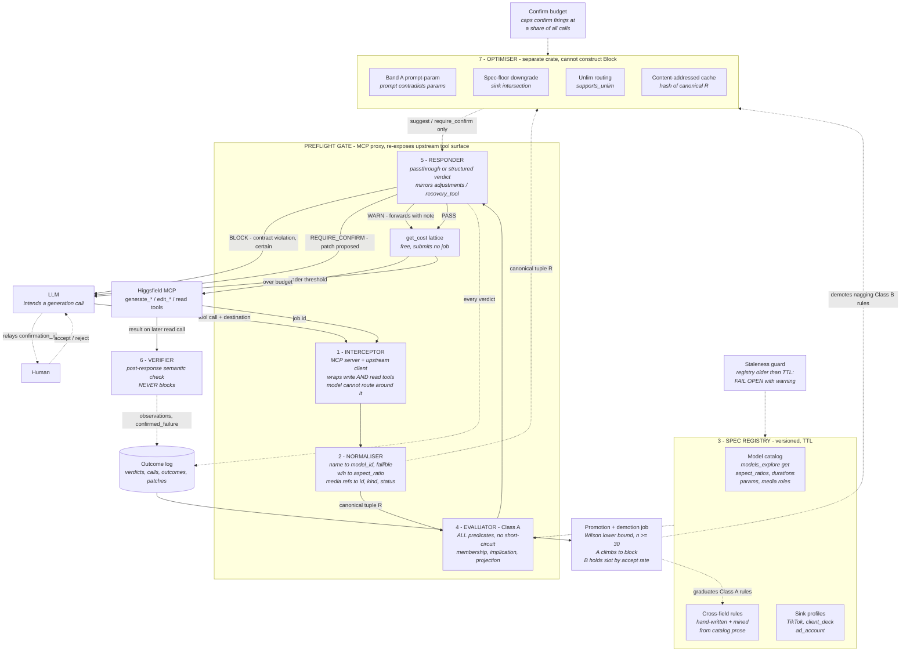

# Preflight Gate — Build Spec

Single source of truth. Supersedes `preflight_gate_architecture.mermaid`, which is now
folded into this document.

A deterministic constraint checker between the LLM's intended Higgsfield MCP call and
the MCP server. Holds a machine-readable model of what the backend accepts and refuses
to forward calls that provably violate it. A second, structurally separated component
proposes cheaper or better-formed calls without ever holding the authority to stop one.

**It is not a predictor.** The block path is Class A only: contract violations, knowable
before the call, zero false positives. Everything probabilistic lives in the optimiser,
which can suggest and can ask, and cannot block.

---

## 1. Scope

| Class | What it is | Maximum authority | Where it lives |
|---|---|---|---|
| **A** | Contract violations provable from the catalog and the request | `block` | `gate-eval` |
| **B** | Quality, cost, and prompt-shape judgement with non-zero false-positive rate | `require_confirm`, `suggest` | `gate-optimise` |
| **Out** | Harmful-content moderation | none | not built |

Content moderation stays out on engineering grounds, not principle. Higgsfield already
moderates and reports `nsfw` and `ip_checking` states, so we would be duplicating it with
strictly less information; a subjective judgement adjacent to the block path destroys the
zero-false-positive property that makes `block` safe at all; and a false block on safety
grounds is unrecoverable from the caller's side. Relaying a backend-reported state (see
`element_status_completed`) is a fact, and stays Class A.

---

## 2. Non-negotiable constraints

Expensive to rediscover. Do not relax without raising it first.

1. **In-path, not a tool.** The gate is an MCP proxy. It must NOT be exposed as a tool the
   model can choose to call. Under instruction pressure the model skips it, and the
   skipped call is the expensive one.
2. **Evaluate all predicates, no short-circuit.** Return the complete violation set so one
   round trip fixes everything. Short-circuiting causes retry whack-a-mole.
3. **Fail open on stale spec.** If the registry is older than its TTL, warn and forward.
   Never block on a spec you cannot vouch for. Blocking valid calls is this system's worst
   failure mode.
4. **Registry is read-only to the evaluator.** Only the promotion job writes rules. Every
   block traces to a rule id plus the outcome data that promoted it.
5. **Log every verdict**, including on forwarded calls. You need the denominator to detect
   rules firing on calls that would have succeeded.
6. **The return path never blocks.** By the time a result exists the credits are spent, so
   a verifier failure destroys value already paid for. Return-path verdicts are
   annotate-and-log only.
7. **The optimiser cannot construct `Block`.** Enforced by the type system, not by
   convention. See §4.
8. **Ambiguity degrades to pass.** Any normalisation the gate cannot resolve with certainty
   (see the name-collision hazard in §7) forwards the call untouched. Uncertainty must
   never resolve toward blocking.

---

## 3. Deployment shape

A standalone MCP proxy server. The MCP client (Claude Code) is pointed at the gate instead
of Higgsfield; the gate re-exposes the upstream tool surface and holds its own client to
the real server. This is the only construction where constraint 1 actually holds against an
off-the-shelf client.

Consequences:

- The gate owns the tool schemas it re-exposes, which is how `destination` gets injected
  (§5).
- The gate must proxy the **read** tools (`jobs_wait`, `job_display`, `show_generations`,
  `show_generation_by_ids`) as well as the write tools. Read-only, purely so the verifier
  can see results. Higgsfield generation is asynchronous: a submit returns a job id and the
  artifact arrives on a later, separate call.
- The gate cannot force a human into the loop. A `require_confirm` reaches the LLM, and the
  LLM decides whether to surface it. §11 covers what can be done about that.

---

## 4. Stack

**Rust.** The reason is compile-time enforcement of the constraints above, not performance.
A generation call takes 10 to 60 seconds; whether the gate costs 200µs or 20ms is invisible.

| Constraint | Rust mechanism |
|---|---|
| 4 — registry read-only to evaluator | `gate-eval` receives `&Registry`; only `gate-promote` holds `&mut`. A write does not compile. |
| 7 — optimiser cannot block | `Verdict::Block` carries a `BlockAuthority` witness whose constructor is private to `gate-core` and mintable only from a `ClassARule`. `gate-optimise` has no path to one. |
| 2 — no short-circuit | Predicates return `Option<Violation>`; the evaluator returns `Vec<Violation>`. There is no `?` to early-return through. |

Serde also gives the normaliser explicit control over unknown fields, which a transparent
proxy needs: silently dropping a field you do not model is its own credit-burning bug.

**Crate layout**

```
crates/
  gate-core/      R, Verdict, Violation, BlockAuthority (private ctor)
  gate-registry/  catalog fetch, merge, TTL, rule loading
  gate-eval/      Class A predicates. Holds &Registry.
  gate-verify/    post-response semantic verifier. Emits observations only.
  gate-optimise/  Class B. Can construct Suggest and RequireConfirm. Cannot construct Block.
  gate-log/       outcome log (SQLite via rusqlite)
  gate-promote/   promotion and demotion job. Sole holder of &mut Registry.
  gate-proxy/     bin: MCP server plus upstream client (rmcp)
```

**Open risk:** MCP's mature SDKs are TypeScript and Python. The official Rust SDK (`rmcp`)
covers both client and server, which is the shape a proxy needs, but it is younger. Verify
its current state with a half-day spike before committing (see §15, step 0).

**Rules are data, never Rust code.** Rules churn; the engine does not. Rule files are JSON
loaded by `gate-registry`, so tuning a predicate never triggers a rebuild.

---

## 5. Request tuple

```
R = (tool, model_id, params, medias, destination, destination_source, budget_ctx)
```

`destination ∈ {tiktok, client_deck, ad_account, none}` is not in the upstream MCP schema.
The gate adds it as a parameter on the schemas it re-exposes, and the proxy config carries
a default for when the caller omits it.

`destination_source ∈ {explicit, default}` is carried alongside, and it is load-bearing:

> **Sink-profile rules may only reach `block` when `destination_source = explicit`.**
> A defaulted destination caps those rules at `warn`, because the constraint was inferred
> rather than stated. Membership and cross-field rules are unaffected.

Everything downstream assumes R is canonical.

---

## 6. Architecture



---

## 7. Components

§18 traces a single request through all of these end to end.

### 1. Interceptor
The MCP server half of the proxy plus an upstream client. Single choke point for
`generate_image`, `generate_video`, `generate_*_batch`, and the edit tools (`upscale_*`,
`reframe`, `outpaint_image`). Also proxies the read tools read-only to feed the verifier.

### 2. Normaliser
Canonicalise before any predicate runs, so each rule is written once:

- friendly model name to machine `model_id`, **fallibly** (see hazard below)
- `width`/`height` to `aspect_ratio`
- media refs to `(id, kind, status)` triples; `kind ∈ {media_input, image_job, video_job}`

> **Name-collision hazard.** Friendly name to `model_id` is not injective.
> `cinematic_studio_video` and `cinematic_studio_video_v2` are both named
> "Cinema Studio Video", and they disagree on exactly the fields the gate checks: v1 allows
> `durations: [5, 10]` while v2 allows `duration_range: {min: 3, max: 12}`, and v2 has an
> entirely different parameter set. Resolving that wrong blocks a valid call. Name
> resolution returns `Resolved(model_id)` or `Ambiguous(Vec<model_id>)`, and `Ambiguous`
> forwards untouched under constraint 8.

### 3. Spec registry (versioned, TTL)
Three sources merged:

- **Model catalog** — cached from `models_explore(action='get')`. Richer than it first
  appears: per-model `aspect_ratios`, `medias[].roles`, media `max`/`required`, and
  `parameters[]` carrying `type`, `options`, `min`, `max`, `default`, `required`. Most
  membership predicates are **derived from this, not authored**.
- **Cross-field rules** — JSON data. Seed set in §8. Each rule declares
  `depends_on: ["cinematic_studio_3_0.duration_range", ...]`, naming the catalog fields its
  predicate reads. The registry diffs those across catalog versions; a changed dependency
  auto-suspends the rule to `warn` pending re-verification (§19).
- **Sink profiles** — per destination. TikTok photo: JPEG/WebP only (PNG rejected, and
  Higgsfield image gen emits PNG), ≤20MB, fits 1920x1080 or 1080x1920, ≤35 images. TikTok
  video: MP4/WebM/MOV, ≤1GB, 3–600s, ≥360px both sides, 23–60 FPS.

> **Duration is a sum type, not a list.** `cinematic_studio_video` has `durations: [5, 10]`
> (enum), `cinematic_studio_3_0` has `duration_range: {min: 4, max: 15}` (interval), and
> `clipify` has neither. Model it as `Enum(Vec<u32>) | Range{min, max} | Unconstrained`.

### 4. Evaluator (Class A)
Runs every predicate, collects violations. Four predicate shapes:

- **Membership** — `params.aspect_ratio ∈ spec[model].aspect_ratios`. Derived from catalog.
- **Implication** — `model = kling3_0 ∧ uses_element(prompt) ⟹ ∃ m ∈ medias : m.role = start_image`
- **Projection** — evaluates a property of the not-yet-existing artifact via a deterministic
  params-to-output function. Valid for format, dimensions, duration, FPS. NOT valid for
  anything about content.
- **Presence** — required params and required media present, media count within `max`.
  Derived from catalog.

### 5. Responder
Passthrough, or a structured verdict mirroring the server's own `adjustments` /
`recovery_tool` shape so the model handles it through a path it already follows:

```json
{
  "verdict": "block",
  "rule_id": "kling3_start_image_required",
  "class": "A",
  "field": "medias",
  "observed": {},
  "allowed": {},
  "suggested_patch": {},
  "alternatives": null,
  "confirmation_id": null
}
```

`suggested_patch` is nullable. A rule that can identify a conflict without being able to
resolve it (see §20) emits `suggested_patch: null` and populates `alternatives` with the
candidate resolutions instead. Every Class A verdict and every claim-versus-parameter
verdict carries a patch; only claim-versus-claim conflicts use the alternatives form.

Verdicts:

| Verdict | Meaning | Who can emit |
|---|---|---|
| `block` | Contract violation, certain | `gate-eval` only |
| `require_confirm` | Patch proposed, caller decides | `gate-optimise`, plus Class A for expensive-and-ambiguous |
| `warn` | Forwards with a note | both |
| `suggest` | Advisory, forwards silently into the log | `gate-optimise` only |
| `pass` | Nothing to say | both |

**New Class A rules start at `warn`. Always.** They reach `block` only through §12.

### 6. Verifier (post-response, never blocks)
Closes the loop that makes promotion possible. Without it, a `kling3_0` call that silently
ignored the element returns a perfectly valid video and is indistinguishable from success in
the log, so `k` in §12 has no honest source.

Because generation is asynchronous, the verifier is not the return leg of the same request:

1. At submit, persist `job_id -> (R, projection, cost_estimate)`.
2. When a result-bearing read call passes through the proxy, correlate on `job_id`.
3. Compare the actual artifact against the projection: format, dimensions, duration, FPS,
   and whether referenced elements were genuinely applied.
4. Write `verifier_result` and `confirmed_failure` to the log. Emit nothing to the caller
   beyond an annotation.

This also replaces the periodic canary with a continuous one: every call re-tests the
projection assumption, so projection unsoundness surfaces the first time it happens rather
than at the next canary run.

### 7. Optimiser (Class B, separate crate)
Reads the canonical R and the registry. Emits `suggest` and `require_confirm`. Has no path
to `BlockAuthority`. Contents in §10.

---

## 8. Class A rule set

### Seed cross-field rules

| rule_id | predicate |
|---|---|
| `kling3_start_image_required` | `kling3_0` + reference element silently ignores the element unless a `start_image` is in `medias` |
| `soul_model_restriction` | trained `soul_id` only valid on `soul_2` / `soul_cinematic` |
| `soul_single_subject` | one `soul_id` per generation; multi-subject must route to Elements |
| `unlim_count_cap` | `use_unlim: true` forces `count = 1` |
| `media_value_is_uuid` | `medias[].value` must be a UUID, never an https URL (use `media_import_url` first) |
| `element_status_completed` | referenced elements must be `status: completed`, not processing/ip_checking/nsfw |
| `job_ref_terminal` | referenced `job_id` must be terminal AND successful |
| `ms_default_landscape` | Marketing Studio defaults to 16:9; a `destination: tiktok` request omitting `aspect_ratio` is a predictable failure |

### Rules mined from catalog prose

The catalog documents cross-field constraints in natural language, enforced nowhere. These
are Class A and free to harvest:

| rule_id | predicate | source |
|---|---|---|
| `ms_avatars_exclusive` | pass at most one of `avatars` / `avatar_ids` | `marketing_studio_video.avatar_ids` |
| `ms_avatar_max_one` | `avatar_ids` length ≤ 1 | `avatar_ids.max` |
| `ms_adref_excludes_hooks` | `ad_reference_id` is mutually exclusive with `hook_id` and `setting_id` | `hook_id`, `setting_id` |
| `ms_hooks_preset_scope` | `hook_id` / `setting_id` only on UGC, Tutorial, Unboxing, Product Review, UGC Virtual Try On | `hook_id` |
| `ms_product_ids_plural` | `product_id` (singular) is rejected; only `product_ids` exists | `product_ids` |
| `clipify_single_url` | `urls` must contain exactly one YouTube URL | `clipify.urls` |
| `preset_requires_media` | `higgsfield_preset` requires `preset_id` and exactly one media in role `image` | `higgsfield_preset` |

A maintenance note worth respecting: these were extracted from prose that can change under
you. They are subject to the same TTL and staleness handling as everything else in the
registry.

---

## 9. Band A — prompt contradicts parameters

Class B by the letter of §1, because it reads the prompt. High precision in practice,
because the patch is always mechanical (set a parameter) and never a rewrite of art
direction. Maximum authority `require_confirm`, subject to the budget in §11.

| Prompt asserts | Params say | Silent outcome |
|---|---|---|
| "30 second video" | `cinematic_studio_3_0`, `duration_range.max: 15` | Clamped to 15s, billed |
| "for TikTok" / "vertical" | `marketing_studio_video`, `aspect_ratio` omitted | Defaults 16:9, unusable for the stated sink |
| "silent" / "no audio" | `sound: "on"` (v2 default) or `generate_audio: true` (marketing default) | Unwanted audio, credits spent |
| "slow motion" | `speedramp: "auto"` while a `slowmo` option exists | Effect ignored |
| "horror" | `genre: "auto"` while `horror` is an enum option | Genre control unused |
| Describes several distinct scenes | `multi_shots: false` | Compressed into one shot |
| "no text", "without a logo" | (negation, unhandled by the model) | Known text-to-image failure class |

### Claim extraction

Deterministic. Lexicon plus regex, no model in the loop.

An extractor maps prompt surface forms onto typed claims, and each claim is compared
against the resolved parameter:

| Claim | Surface forms | Compared against |
|---|---|---|
| `Duration(secs)` | `N s / sec / secs / second / seconds`, `N m / min / minute / minutes` | `duration` vs `durations` or `duration_range` |
| `Aspect(vertical\|horizontal\|square)` | vertical, portrait, 9:16, tiktok, reels, shorts, story / horizontal, landscape, 16:9, widescreen / square, 1:1 | `aspect_ratio`, `width`/`height` |
| `Audio(on\|off)` | voiceover, narration, music, with sound / silent, no sound, no audio, muted | `generate_audio`, `sound` |
| `Motion(slowmo\|speedup)` | slow motion, slow-mo, slowmo / sped up, timelapse | `speedramp` |
| `Genre(x)` | matched against the model's own `genre` enum, supplied by the registry | `genre` |
| `ShotCount(n)` | "three scenes", "cut to", "then" | `multi_shots`, `multi_prompt` |
| `Negation(subject)` | no text, without a logo, no watermark | nothing; advisory only |

Two properties are what keep precision high enough for this to sit near the caller:

1. **Claims are compared, never applied.** The extractor never infers what you meant and
   sets a parameter from it. It only notices that two things you already stated disagree.
   That is why every Band A patch is mechanical, and why it can be described to the caller
   in one line.
2. **No claim extracted means no rule fires.** Low recall is safe here, and silence is the
   default. A prompt the extractor does not understand produces no verdict at all.

The `Genre` row generalises the pattern worth reaching for: its vocabulary is *derived from
the catalog*, because each model publishes its own `genre` options. The registry supplies
the lexicon, so the rule stays correct when Higgsfield adds a genre.

Out of scope for Band A: judging that a prompt is vague or will produce poor work. That is
a learned judgement with poor precision, and it is where confirmation fatigue comes from.
If it is ever built, trigger it from an observed reroll rate for that prompt-shape in the
outcome log rather than from a generic quality model.

---

## 10. Credit optimisation

Ordered by how much prediction each requires. Everything here emits `suggest` or
`require_confirm`.

### In scope for v1

**Spec-floor downgrade (deterministic).** The catalog annotates `resolution` options
480p/720p/1080p/4k with "higher = more credits". Intersecting the sink profile's floor with
the request yields the minimum sufficient spec. 4k for a TikTok cut is provable waste.
*Emits `suggest` only.* A silent downgrade is the response-side equivalent of blocking a
valid call, and the caller may legitimately want a 4k master.

**Unlim routing (deterministic).** Catalog items carry `supports_unlim`, and the response
carries `unlim: {available, remaining, expires_at}`. Routing eligible work onto free
generations saves credits at zero quality cost. Eligibility is itself a cross-field
predicate, since the trailing "Unlim configs" text constrains covered configurations, and
it collides with `unlim_count_cap`: unlim and batching are mutually exclusive. Free but
serial.

**`get_cost` as a lattice, not a tripwire.** `get_cost: true` is free and submits no job, so
price the whole configuration lattice (model × resolution × duration) for zero credits and
pick the cheapest point satisfying the constraints. Memoise per `(model, param-shape)` and
refresh on the registry TTL rather than querying per request.

**Content-addressed cache.** Hash the canonical R post-normaliser, which is what lets
"Nano Banana Pro" + `width`/`height` collide with `nano_banana_pro` + `aspect_ratio`.
*Offered, never served:* generation is stochastic and a repeat call is frequently a
deliberate reroll, so a cache hit emits `require_confirm` carrying the prior `job_id`.

### Deferred, with reasons recorded

**Draft-then-escalate cascade.** The strongest result in the literature (FrugalGPT reports
up to 98% cost reduction matching GPT-4; RouteLLM 85% at 95% quality), but it does not
transfer naively. In an LLM cascade you *keep* the cheap answer; here you discard the draft
and regenerate, so savings depend on the draft's accept/reject decision transferring to the
expensive tier. Diffusion at a different resolution or mode often produces a different
image rather than a lower-fidelity version of the same one. Cascaded diffusion works because
the low-res sample is conditioned into the upscaler, and Higgsfield gives no such guarantee.
**The version that does work:** draft a cheap image, get approval, pass it as `start_image`
into the expensive video. `cinematic_studio_3_0` and `cinematic_studio_video_v2` both accept
`start_image` in `medias[].roles`, so identity genuinely carries. Build this after the log
has a baseline.

**Semantic near-duplicate cache — index but never serve.** Threshold sets hit rate and
false-positive rate simultaneously. In text a false hit yields a slightly-off answer; here
it yields the wrong video and nobody notices until the client does. Prompt similarity is
also a weak predictor of output similarity in diffusion. Build the embedding index as an
observability surface that flags near-duplicate spend, with no serving path.

**Auto-select instead of reroll.** Aesthetic predictors do not condition on the prompt, so
they measure pretty rather than correct; a CLIP adherence score is needed for the other
half. Drags local model inference into the binary. A mediocre scorer is worse than none,
because it systematically promotes slop.

**Adaptive n / early stopping.** Reported 15-35% fewer generations at equal quality, but the
same work notes it sacrifices Best-of-N parallelism, and serial rounds on 30-second video
generations are a real wall-clock cost. Moot under unlim, which caps `count` at 1 anyway.

### Rejected

**Speculative precompute.** The prefetch literature's economics rest on wasted work filling
otherwise-idle accelerator time, so waste costs energy rather than money. That premise
inverts here: every speculative generation is billed at full rate. At a 50% hit rate you
double spend to halve latency, inside a system whose purpose is spending less. Precompute
belongs on the free things: catalog fetches, cost lattices, sink profiles, name-resolution
tables.

---

## 11. The confirm budget (fatigue guard)

`require_confirm` introduces the mirror image of the false-block problem: individually
cheap, paid on every call. Left unguarded, the model and the human both start
rubber-stamping and the whole path becomes overhead.

**Relay enforcement.** The gate holds the call and requires the resubmit to carry the exact
`confirmation_id` it issued. That does not prove a human saw it, but it does force the model
to relay the structured payload, which surfaces it in the transcript. Record
`turnaround_ms`; sub-second acceptance is a strong signal nobody read it.

**Global budget.** Confirm firings are capped at a configured share of all calls over a
trailing window (default 10%). Rules compete for the budget ranked by their accept-rate
lower bound, and the lowest is dropped first when the cap binds.

**Automatic demotion.** A rule holds its slot on measured accept rate, using the same
statistics as promotion in the opposite direction. A nagging rule dies on its own rather
than waiting for someone to notice.

**Budget is weighted by answer cost.** A yes/no confirm carrying a mechanical patch is cheap
to answer. A confirm carrying `alternatives` asks the caller to choose, which costs more
attention and burns goodwill faster. Alternatives-shaped rules therefore draw a reduced
slice of the budget and clear a higher accept-rate bar (§12). Without this weighting, the
most annoying rule class quietly consumes the budget that the cheap, obviously-correct rules
earned.

---

## 12. Promotion and demotion

The only statistical part. Both directions use the Wilson score lower bound, and Wilson
specifically: at `p` near 1 the normal approximation breaks and promotes rules early.

```
        p̂ + z²/2n − z·√( p̂(1−p̂)/n + z²/4n² )
L(k,n) = ─────────────────────────────────────       p̂ = k/n,  z = 1.96 at 0.95
                    1 + z²/n
```

**Class A: `warn` climbs to `block`** when `L(k, n) > 0.99` and `n ≥ 30`, where `k` is
confirmed failures among `n` firings. 30/30 clears; 29/30 does not. `k` comes from the
verifier (§7.6), which is why the verifier is built before any rule can graduate.

**Promoted rules do not stop being measured.** A `block` verdict is self-blinding: you
never run the calls it stops, so `k/n` would otherwise freeze on promotion day and never
move again, however far the catalog drifts. The randomised holdout in §19 keeps `n` growing
for promoted rules, and its observations feed this same bound. A promoted rule whose
`L(k, n)` falls back below 0.99 is demoted to `warn` automatically.

**Class B: a confirm rule holds its slot** when `L(accepts, firings) > 0.5` and
`n ≥ 30`. Below the bar, it is demoted out of the confirm path to `suggest`. Same log, same
statistics, opposite direction. Alternatives-shaped rules (§20) clear `L > 0.65` instead,
because a question that costs more to answer has to be right more often to be worth asking.

Sanity check per Class A rule:

```
E[gain] = p_fail·(C_credits + C_latency + C_rework) − (1 − precision)·C_false_block
```

For genuine contract violations `C_false_block ≈ 0` (the call was failing anyway), so this
is trivially positive. The moment a rule has `precision < 1` this stops being obviously
positive, and that is the signal it belongs in Class B.

---

## 13. Outcome log

SQLite, embedded, no infra. Written by every path, read by the promotion job.

```sql
verdicts(id, ts, request_hash, tool, model_id, destination, destination_source,
         rule_id, class, verdict, firing_id)
calls   (request_hash, job_id, submitted_at, r_json, projection_json, cost_estimate)
outcomes(job_id, terminal_status, completed_at, artifact_json,
         verifier_result, confirmed_failure)
patches (firing_id, rule_id, patch_json, disposition, decided_at, turnaround_ms)
```

`disposition ∈ {accepted, rejected, ignored}` is what §11 and §12 run on.

---

## 14. Known failure modes and their guards

| Failure mode | Guard |
|---|---|
| **Registry staleness.** Higgsfield ships a model change, rules go stale silently and start blocking valid calls. | TTL plus fail open (constraint 3). |
| **Projection unsoundness.** The params-to-output mapping changes under you. If image gen stops emitting PNG, the TikTok rule inverts from useful to harmful and nothing says so. | The verifier re-tests the assumption on every call, continuously. |
| **Class B leakage.** Quality rules inheriting block authority because they share a repo. | Separate crate plus the `BlockAuthority` witness. Structural, not procedural. |
| **Name-collision misresolution.** Two models share a friendly name and disagree on checked fields. | `Ambiguous` forwards untouched (constraint 8). |
| **Confirmation fatigue.** The confirm path fires often enough that everyone rubber-stamps. | Global budget, relay enforcement, automatic demotion (§11). |
| **Silent auto-accept.** The LLM takes the patch and resubmits without surfacing it. | `confirmation_id` relay requirement plus `turnaround_ms` in the log. Measurable rather than preventable. |
| **Silent downgrade.** The optimiser quietly reduces spec and the caller loses the master they wanted. | Spec-floor emits `suggest` only; it can never rewrite a request. |
| **Promoted rules go dark.** A blocked call is never observed, so a rule that has become wrong generates no evidence that it is wrong. | Randomised holdout (§19), with ε raised on promotion and on dependency change. |
| **Rule dependency drift.** The catalog changes in a way that invalidates a rule, while the registry is still fresh so the TTL guard never fires. | Rules declare `depends_on`; a changed dependency auto-suspends to `warn` (§19). |

---

## 15. Build order

0. **Spike `rmcp`.** Half a day. Confirm client and server in one process, schema
   re-exposure, and passthrough of unknown fields. This is the only stack risk.
1. **Proxy skeleton.** Interceptor, normaliser, passthrough, `destination` injection. Zero
   rules loaded. Prove nothing breaks.
2. **Outcome log, plus the replay corpus and CI harness it feeds.** Before any rule exists.
   You need the baseline, and you need the known-good negative set wired into CI before the
   first predicate can regress against it (§19).
3. **Registry, catalog only.** TTL and fail-open. Derived membership and presence predicates
   at `warn`. Name resolution with `Ambiguous` handling.
4. **Verifier, with its own labelled ground-truth set.** Job correlation and semantic result
   check. The labelled set is not optional: the verifier is the source of `confirmed_failure`,
   so an unmeasured verifier makes every statistic in §12 unfalsifiable (§19). This moved
   earlier than the
   original order because §12 cannot promote anything without an honest `k`.
5. **Seed cross-field rules** at `warn`, including the mined set in §8.
6. **Sink profiles and projection predicates** at `warn`, with `destination_source` tracked.
7. **Band A prompt-parameter rules** at `require_confirm`, behind the confirm budget.
   `patches` table live.
8. **`get_cost` lattice and budget threshold.**
9. **Promotion and demotion job, with the holdout shipped alongside it.** Nothing reaches
   `block` except through it, and nothing stays at `block` without holdout evidence (§19).
10. **Optimiser Tier 0.** Spec-floor downgrade, unlim routing, content-addressed cache, all
    as `suggest` or `require_confirm`.

---

## 16. Decision log

Recorded so they are not relitigated by accident.

- **Rust, for compile-time invariant enforcement rather than speed.** Performance is
  irrelevant against a 10-60s generation call. The type system is what makes constraints 4
  and 7 real.
- **MCP proxy, not an embedded library.** The caller is an off-the-shelf MCP client, so the
  proxy is the only shape where the model cannot route around the gate.
- **`destination` as a schema parameter with a config default**, and sink rules capped at
  `warn` when the value was defaulted. Preserves zero false positives on the block path.
- **The thin bidirectional layer is a semantic result check**, not a wire-level structural
  one. It exists to give promotion an honest `k`.
- **Credit optimisation is Class B in its entirety**, with no exceptions, and lives
  outside the block path. Spec-floor and unlim routing are deterministic in their
  *calculation*, but acting on either is still a judgement about what the caller wanted.
- **Harmful-content moderation is out of scope** (§1), on duplication and
  false-block-cost grounds.
- **Blocks are held open to measurement.** A promoted rule keeps a randomised bypass
  fraction so its precision estimate stays alive (§19). Deliberately spending a little on
  calls we expect to fail is the price of ever knowing a rule has gone wrong.
- **Prompt integrity is one mechanism, not two.** Incompleteness and contradiction collapse
  into the same comparison once defaults are resolved (§20). Judging a prompt merely thin
  stays out of scope, with cost-triggered default disclosure and post-hoc reroll statistics
  as the deterministic substitutes.

---

## 17. Operating the gate

### Installation

The gate replaces the Higgsfield entry in the MCP client config. Keep the server name
identical so tool names do not change and nothing downstream notices:

```json
{
  "mcpServers": {
    "higgsfield": {
      "command": "preflight-gate",
      "args": [
        "--upstream-config", "~/.config/preflight-gate/upstream.json",
        "--default-destination", "none",
        "--confirm-budget", "0.10"
      ]
    }
  }
}
```

The gate holds the real Higgsfield credentials in `upstream.json`. The client never talks
to Higgsfield directly again, which is the point: there is no path around the gate that
does not involve editing this file.

### What "detection" means

Two layers, and only the second one is doing anything interesting.

**Layer 1: routing. Not detection at all.** The gate never sees your English. By the time
anything arrives, the model has already decided to call `generate_video` and has emitted a
structured tool call. The gate sees that call because it is the server serving the tool. A
message like "make me a video of the trainers" is invisible to the gate; the *tool call* it
produces is not. This is 100% reliable for exactly the reason it sounds trivial: it is
transport, not inference.

**Layer 2: claim extraction from the `prompt` field inside the call.** This is where
semantics enter, and it is scoped hard by §9: read the prompt only to find assertions that
contradict parameters sitting in the same call. It is a disagreement detector, and it is
deliberately deaf to everything else.

The consequence worth internalising: **the gate cannot save you from a prompt that is
merely bad.** It catches a prompt that argues with its own parameters. Those are different
problems, and conflating them is how this system would grow a false-positive rate.

### What you will actually see

| Situation | What happens | What you see |
|---|---|---|
| Nothing wrong | Forwarded, verdict logged | Nothing. The gate is invisible on the happy path, and that is the design target. |
| Contract violation, rule promoted | Blocked before submit, zero credits | Claude receives the full violation set, fixes it, resubmits. One extra turn, no spend. |
| Contract violation, rule still at `warn` | Forwarded with a note, logged | Nothing, unless it fails, in which case the verifier records it and the rule accrues evidence toward promotion. |
| Prompt argues with parameters | `require_confirm` with a mechanical patch | A question: here is what you said, here is what the call does, apply the patch or send it as-is. |
| Gate cannot resolve something | Forwarded untouched, logged | Nothing. Ambiguity always resolves toward letting you through. |

### Your part

Answer the confirmations honestly, including rejecting them. `disposition` is not
bookkeeping: §11 and §12 run demotion on it. A rule you reject 60% of the time drops out
of the confirm path by itself within 30 firings. Rubber-stamping a rule you disagree with
keeps it alive and nagging, and answering honestly is what makes the confirm path
self-pruning.

If the gate ever blocks something valid, that is the worst outcome this system has (§2,
constraint 3). It should be reported and the rule demoted, not worked around.

---

## 18. Worked example

One request, all the way through. Every catalog fact below is real: `cinematic_studio_3_0`
publishes `duration_range {min: 4, max: 15}`, a `generate_audio` bool defaulting to `false`,
a `resolution` enum defaulting to `720p`, and `aspect_ratios` including `9:16`.

### The call

The caller types "make me a 30 second cinematic video of the trainers with a voiceover,
vertical for TikTok". The model emits:

```json
{ "tool": "generate_video",
  "model": "Cinema Studio Video 3.0",
  "prompt": "cinematic product shot of the trainers with a voiceover, vertical, 30 seconds",
  "duration": 30,
  "destination": "tiktok" }
```

Note what is absent: `aspect_ratio`, `generate_audio`, `resolution`. Absent parameters are
where most of the money goes, because their defaults are invisible at the call site.

### The trace

**1. Interceptor** receives it over stdio, because the gate is the server registered as
`higgsfield`. Assigns `request_id`. Nothing forwarded yet.

**2. Normaliser.** `"Cinema Studio Video 3.0"` resolves cleanly to `cinematic_studio_3_0`.
No `width`/`height` to fold. `destination: tiktok` with `destination_source: explicit`,
which unlocks full authority for sink rules per §5. Canonical `R` built, `request_hash`
computed.

**3. Registry.** Catalog entry loaded, TTL fresh. Had it been stale, evaluation stops here
and the call forwards with a warning (constraint 3), no exceptions.

**4. Evaluator (Class A), every predicate, no short-circuit:**

- *Presence:* nothing required is missing. Pass.
- *Membership:* `resolution` absent, resolves to default `720p`, which is in options. Pass.
- *Range:* `duration: 30` against `duration_range {4, 15}`. **Violation.** Higgsfield clamps
  to 15s and bills for it. Rule `duration_range_exceeded`, derived from the catalog, already
  promoted to `block` because every firing is a confirmed clamp.
- *Projection:* output would be MP4, 720p, within TikTok's 3-600s and above 360px.
  **No sink violation.** Worth being precise: TikTok's *video* profile carries no aspect
  constraint, so 16:9 would be accepted. The vertical problem here is a fit problem rather
  than a contract one, so Class A correctly has nothing to say about it.

Evaluation continues past the block, per constraint 2.

**5. Optimiser (Class B), same canonical R:**

- `Duration(30s)` extracted, but Class A already owns that field. Deduplicated, Class A wins.
- `Audio(on)` extracted from "voiceover"; resolved `generate_audio` is the default `false`.
  **Contradiction.** Patch `{generate_audio: true}`.
- `Aspect(vertical)` extracted from "vertical" and "tiktok"; `aspect_ratio` is absent.
  **Contradiction.** Patch `{aspect_ratio: "9:16"}`.
- *Spec-floor:* 720p is already at the sensible floor for this sink. Silent. Had the caller
  asked for 4k, this is where a `suggest` would appear.
- *Cache:* `request_hash` unseen. Silent.
- *Confirm budget* has room, so both fire and each is issued a `confirmation_id`.

**6. `get_cost`: skipped entirely.** A block exists, so nothing is priced and nothing is
submitted. **Zero credits spent.**

**7. Responder** returns one payload carrying the complete set:

```json
{ "verdicts": [
  { "verdict": "block", "rule_id": "duration_range_exceeded", "class": "A",
    "field": "duration", "observed": 30, "allowed": {"min": 4, "max": 15},
    "suggested_patch": {"duration": 15} },
  { "verdict": "require_confirm", "rule_id": "banda_audio_contradiction", "class": "B",
    "field": "generate_audio",
    "observed": {"prompt_claim": "voiceover", "resolved": false},
    "suggested_patch": {"generate_audio": true}, "confirmation_id": "cfm_7c1e" },
  { "verdict": "require_confirm", "rule_id": "banda_aspect_contradiction", "class": "B",
    "field": "aspect_ratio",
    "observed": {"prompt_claim": "vertical", "resolved": null},
    "suggested_patch": {"aspect_ratio": "9:16"}, "confirmation_id": "cfm_9a04" }
]}
```

**8. Log:** three `verdicts` rows, no `calls` row (nothing was submitted), two `patches` rows
sitting at `ignored`.

**9. The model's turn.** It fixes the block itself and surfaces the two questions, because
the `confirmation_id` requirement (§11) means it cannot resubmit without relaying them.

**10. Resubmit** with `duration: 15`, `generate_audio: true`, `aspect_ratio: "9:16"`, both
ids attached. Evaluator clean. Optimiser silent, since the claims and the parameters now
agree. `get_cost` prices it, under threshold, forwarded upstream. Job id returns.

**11. Log:** patches move to `accepted` with `turnaround_ms` recorded. `calls` row written
with R, the projection, and the cost estimate.

**12. Later, the verifier.** The caller's `jobs_wait` routes through the proxy too.
Correlate on `job_id`, compare the artifact against the stored projection: 15s, 9:16, audio
present, MP4. All match. `confirmed_failure: false` written to `outcomes`.

Step 12 is the entire reason §7.6 exists. Without it, §12 has no honest `k`.

### The same call, one word different

Had the model said `"model": "Cinema Studio Video"`, the normaliser returns
`Ambiguous([cinematic_studio_video, cinematic_studio_video_v2])`. Those two disagree on
duration (`[5, 10]` enum versus `3-12` continuous), so the gate cannot know whether 30 is
wrong or in what way. Every model-specific predicate is skipped, the call forwards
untouched, and the log records `normalisation_ambiguous`.

The gate chooses to be useless rather than wrong. That is constraint 8, and it is the single
most important behaviour in the system.

---

## 19. Evaluation and benchmarking

### The measurement problem

The gate's value is counterfactual. It claims credits saved on calls that were never run,
so the saving is inferred rather than observed. Worse, a `block` verdict is **self-blinding**:
once a rule is promoted you stop seeing outcomes for it, `k/n` freezes on promotion day, and
a rule that later becomes wrong produces no evidence anywhere in the system that it is wrong.
Everything below exists to make the counterfactual observable.

### Four regimes

| Regime | Answers | Runs |
|---|---|---|
| **Shadow** (everything at `warn`) | What would we have blocked, and would it have failed? | Build steps 3-8, and permanently for every unpromoted rule |
| **Holdout** (ε bypass on `block`) | Are promoted rules still right? Does a Class B rule actually help? | Continuously, post-promotion |
| **Replay corpus** | Does this rule change break something we already know about? | CI, every rule edit |
| **Contract tests** | Do the catalog fields this rule reads still exist with the assumed shape? | Every TTL refresh |

Shadow needs no new machinery. "New rules start at `warn`" already *is* shadow evaluation,
and step 2's outcome log supplies the pre-rule baseline.

### The randomised holdout

Forward a fraction ε of calls a promoted rule would block, and observe what actually happens.

Each holdout call reveals a false block with probability `1 − p`. To catch a rule that has
degraded to `p = 0.9` with 95% confidence:

```
n ≥ log(0.05) / log(0.9) ≈ 29
```

which is the same n≈30 as §12, for the same statistical reason. Catching degradation to
`p = 0.99` needs `n ≈ 298`. **The holdout detects gross failure quickly and subtle drift
slowly**, and no tuning changes that. Budget accordingly, and do not claim more sensitivity
than the arithmetic supports.

ε is adaptive, so spend concentrates where uncertainty actually is:

| Condition | ε | Rationale |
|---|---|---|
| Stable, promoted > 60 days, no dependency change | 0.02 | Background liveness check |
| First 14 days after promotion | 0.25 | Promotion is the moment you know least |
| Any catalog change touching the rule's `depends_on` | 0.25 for 14 days | Targets the staleness risk directly |

The same mechanism serves Class B. Withhold the confirm on ε of Band A firings, let the call
through unpatched, and compare downstream reroll rate against the patched population. Accept
rate tells you a rule is tolerated; the holdout tells you it works.

### Metrics

**Primary.** *Round trips from intent to accepted artifact* is the best single number: it
captures savings and friction together, and it cannot be gamed by a rule that blocks
everything.

- Credits saved per 1000 calls: `Σ cost_estimate × P(fail)` over blocked calls, with
  `P(fail)` taken from holdout observations rather than the promotion-day estimate
- False block rate: target zero. A constraint, never a quantity to trade against.
- **Total credits spent**, observed directly

The last one is load-bearing. "Credits saved" is derived and model-dependent, and it can look
excellent while total spend rises because blocks provoked extra retry cycles. Report both,
and when they disagree believe the observed one.

**Counter-metrics.** These catch the system flattering itself:

- **Blocked-then-abandoned rate.** The caller hits a block and gives up rather than fixing.
  That is the gate destroying work outright, and it appears in none of the primary metrics.
- Confirm turnaround under 1s (rubber-stamping, §11)
- Normalisation ambiguity rate: how often the gate is choosing silence
- Fail-open rate from registry staleness

**Performance.** Mostly irrelevant against a 10-60s generation call, with two exceptions
worth a budget so they cannot silently regress: added latency on the happy path (target
under 10ms) and the bounded cost of the `get_cost` lattice.

### Two things that need their own ground truth

**The verifier is an unmeasured measuring instrument.** It produces `confirmed_failure`, so
every statistic in §12 inherits its errors. It needs a hand-labelled set of known-good and
known-silently-failed generations, roughly 100 cases weighted toward the silent-failure
class, since that is the hard one and the reason the component exists. Scored independently,
refreshed when the catalog changes materially.

**Rule dependency contracts.** Each rule's `depends_on` (§7.3) is asserted against the live
catalog on every TTL refresh: the field exists, and its shape matches what the predicate
assumes. A `duration_range` that becomes a `durations` enum should suspend the rule, not
silently mis-evaluate it. This is a strictly better staleness guard than TTL alone, because
TTL catches "the catalog is old" while this catches "the catalog changed in a way that
invalidates rule 7."

### Offline corpus

Two halves, both in CI:

- **Replay corpus** — recorded real `R` tuples with their observed outcomes, harvested from
  the outcome log.
- **Synthetic corpus** — hand-written boundary cases per rule: 15s, 16s, and 30s against a
  `{4, 15}` range, plus each rule's negative space.

The negative set matters more than the positive set. **A rule change that fires on any
known-good call fails CI**, which is how the zero-false-positive property in §1 stops being
an aspiration and becomes a build gate.

---

## 20. Prompt-integrity guards

### Incompleteness and contradiction are the same problem

An omitted `aspect_ratio` on Marketing Studio is not neutral; it is a silent assertion of
16:9. Once the normaliser resolves defaults from the catalog, **there is no unspecified
parameter, only an unstated default**, and incompleteness becomes contradiction. "For TikTok"
with no aspect ratio and "for TikTok, landscape" are the same violation arriving by different
routes.

That collapse is why this costs almost nothing to build. §9's extractor already produces
typed claims. What widens is the set of things a claim is compared against.

### Comparison targets

| Claim compared to | Example | Class | Max authority |
|---|---|---|---|
| **Resolved parameter** (defaults included) | "voiceover" vs `generate_audio: false` | B | `require_confirm` |
| **Another claim of the same type** | "vertical widescreen shot" | B | `require_confirm` |
| **Destination** | "cinematic landscape" vs `destination: tiktok` | B | `require_confirm` |
| **Model capability** | "silent" on a model with no audio control | B | `require_confirm` |
| **Required inputs** | `preset_id` absent on `higgsfield_preset` | **A** | `block` |

Only the last row blocks, and it blocks because it reads a catalog fact rather than your
prose. It is already the Presence predicate in §7.4, so structural incompleteness is covered
today.

The **capability** row needs a narrow definition to stay precise: the claim must contradict a
control the model *lacks entirely*, rather than merely lack a dedicated parameter. Diffusion
models do respond to "slow motion" in prompt text without a matching knob, so absence of a
parameter is not absence of the behaviour. `clipify` and `higgsfield_preset` publish tiny
parameter sets and are where this rule earns its keep.

### Claim-versus-claim breaks the mechanical-patch property

Band A's best property is that every patch is mechanical, which is what makes it cheap to
answer. **That property does not survive claim-versus-claim.** Given "vertical widescreen",
the gate can identify the conflict and cannot resolve it, having no idea which half you meant.

Such rules emit `suggested_patch: null` with `alternatives` populated (§7.5). Two consequences,
the second mattering more:

1. The responder schema carries both shapes.
2. **A choice costs the caller more than a yes/no**, so these rules draw a reduced budget
   slice and clear a higher accept-rate bar (§11, §12).

### Where the line is held

"Make a video of the trainers" contradicts nothing and omits nothing required. It is thin.
Judging thinness is Class C and stays deferred, for the §9 reasons: no ground truth, poor
precision, and the fastest available route to a confirm path nobody reads.

Two substitutes that stay deterministic:

**Cost-triggered default disclosure.** Judge the exposure rather than the prompt. When a call
clears the credit threshold with a high-impact parameter at its default (`mode: std`,
`resolution: 720p`, `multi_shots: false`), emit a `suggest` naming what is unset. That is a
statement of fact about the call rather than a prediction about the artifact, which is exactly
why its precision holds. Hooks into the budget threshold already in §10.

**Post-hoc reroll statistics.** Thinness is measurable afterwards even where it is not
predictable beforehand. The outcome log already supports correlating prompt shape with reroll
rate. A shape that genuinely predicts rerolls at volume becomes evidence for a rule, entering
at `warn` like everything else. Evidence first, rule second.

**Negation** is the one principled exception. "No text", "without a logo" fail for a reason
unrelated to your prompt being unclear: text-to-image models handle negation badly, and none
of the Higgsfield models expose a negative-prompt parameter to route it through. A `suggest`
pointing at positive rephrasing is defensible on that basis. It should never graduate past
`suggest`.
